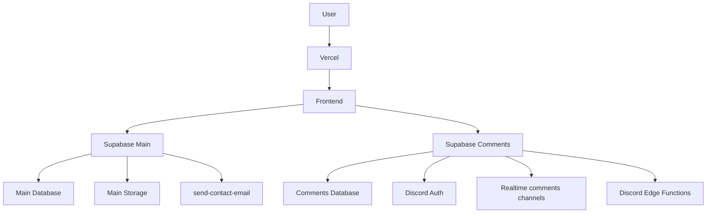

# Supabase Architecture

Date: 2026-07-08
Branch: `architecture/repository-reorganization`

## Current Project Map



## Responsibilities

| Area | Project | Repository path |
| --- | --- | --- |
| Main frontend Supabase client | Main | `src/integrations/supabase` |
| Comments Supabase client | Comments | `src/integrations/supabase-comments` |
| Contact Edge Function | Main | `supabase/projects/main/functions/send-contact-email` |
| Discord Edge Functions | Comments | `supabase/projects/comments/functions` |
| Newsletter/contact/storage migrations | Main | `supabase/projects/main/migrations` |
| Comments/Auth/Realtime/RPC migrations | Comments | `supabase/projects/comments/migrations` |
| Historical mixed SQL | None | `supabase/legacy-mixed/migrations` |

## Environment Matrix

| Environment | Main Supabase | Comments Supabase | Fallback allowed |
| --- | --- | --- | --- |
| Development | Explicit dev ref or approved shared dev ref | Explicit dev comments ref | No |
| Preview | Explicit preview/staging ref | Explicit preview/staging comments ref | No |
| Staging | Explicit staging ref | Explicit staging comments ref | No |
| Production | Explicit production ref | Explicit production comments ref | No |

## Runtime Validation

The frontend validates environment variables in `src/integrations/supabase/env.ts`.

Main client requires:

- `VITE_SUPABASE_URL`
- `VITE_SUPABASE_PUBLISHABLE_KEY`
- `VITE_SUPABASE_PROJECT_ID`

Comments client requires:

- `VITE_COMMENTS_SUPABASE_URL`
- `VITE_COMMENTS_SUPABASE_PUBLISHABLE_KEY`
- `VITE_COMMENTS_SUPABASE_PROJECT_ID`

The project id must match the Supabase URL ref. Example: `https://abc.supabase.co` must use `abc` as the project id.

## Operational Guardrails

- Do not recreate root-level Supabase CLI files.
- Do not deploy functions from the wrong project directory.
- Do not apply `legacy-mixed` migrations directly.
- Do not store service role keys, bot tokens, Resend keys or salts in Vite variables.
- Configure Edge Function secrets in the owning Supabase project.
- Configure Vercel Preview and Production variables separately.

## Commands

Validation:

```bash
npm run lint
npm run typecheck
npm run build
npm run audit:architecture
npm run audit:supabase
```

Supabase CLI examples:

```bash
npm run supabase:workdir:main
npm run supabase:workdir:comments
supabase --workdir .supabase-workdir/main functions list
supabase --workdir .supabase-workdir/comments functions list
```

Publishing, migration application and remote configuration must be approved separately.
