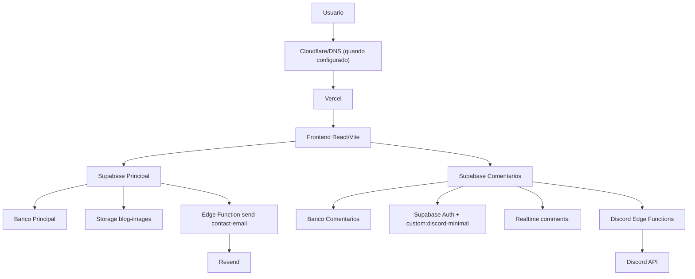
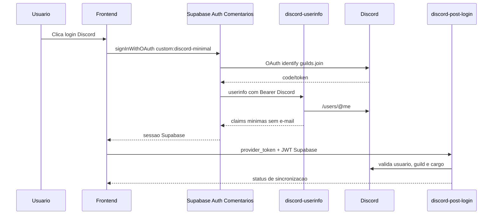
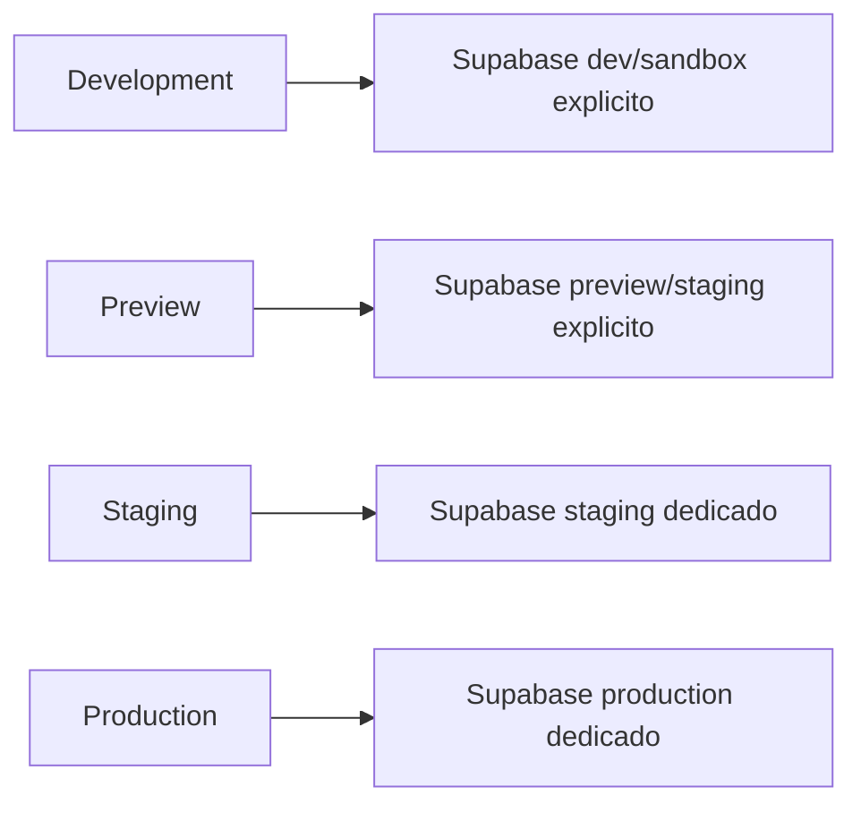

# System Architecture

Data: 2026-07-08
Branch: `architecture/repository-reorganization`

## Visao Geral

A plataforma e uma SPA Vite/React publicada na Vercel, com dois projetos Supabase separados:

- Supabase Principal: dados principais, formulario de contato, newsletter e storage de imagens.
- Supabase Comentarios: login Discord, comentarios, reacoes, Realtime e Edge Functions Discord.

Cloudflare/Hostinger podem existir na camada de dominio/DNS, mas esta branch nao altera DNS, Cloudflare, Hostinger ou producao.



## Frontend

Tecnologias:

- Vite
- React
- TypeScript
- Supabase JS
- React Router

Clientes Supabase:

- Principal: `src/integrations/supabase/client.ts`
- Comentarios: `src/integrations/supabase-comments/client.ts`
- Validacao de env: `src/integrations/supabase/env.ts`

O frontend falha explicitamente se variaveis obrigatorias estiverem ausentes ou se o project ref da URL nao bater com o `PROJECT_ID`.

## Vercel

Responsabilidades:

- build e hospedagem do frontend;
- redirects e headers em `vercel.json`;
- Environment Variables por ambiente;
- Preview Deployments por branch.

Nao devem ser configurados em Vercel:

- service role;
- bot token Discord;
- Resend key;
- salts de rate limit/CAPTCHA.

Esses secrets pertencem ao Supabase, por projeto.

## Cloudflare

Papel esperado:

- DNS;
- proxy/CDN, se habilitado;
- WAF/rate limiting/bot protection, se configurado;
- TLS/HSTS, se for a borda principal.

Esta branch nao altera Cloudflare.

## Hostinger

Papel possivel:

- registro/dominio;
- nameservers;
- e-mail/DNS auxiliar.

Esta branch nao altera Hostinger.

## Supabase Principal

Repositorio:

```text
supabase/projects/main
```

Responsabilidades:

- `profiles`
- `blogs`
- `blog_comments`
- `newsletter_subscribers`
- `contact_rate_limits`
- bucket `blog-images`
- Edge Function `send-contact-email`

Storage:

- bucket: `blog-images`
- leitura publica;
- upload autenticado por pasta do usuario;
- limite 5 MB;
- MIME types: jpeg, png, webp, gif.

## Supabase Comentarios

Repositorio:

```text
supabase/projects/comments
```

Responsabilidades:

- `discord_profiles`
- `comments`
- `comment_reactions`
- `user_roles`
- `discord_identity_migrations`
- `contact_rate_limits` para rate limit das Functions Discord
- Auth Discord customizado
- Realtime de comentarios
- Edge Functions Discord

## Edge Functions

| Projeto | Function | JWT | Funcao |
| --- | --- | --- | --- |
| Principal | `send-contact-email` | true | CAPTCHA, rate limit, envio via Resend |
| Comentarios | `discord-post-login` | true | valida login, vincula identidade, entra no servidor, aplica cargo |
| Comentarios | `discord-refresh-profile` | true | atualiza perfil visual via Discord API |
| Comentarios | `discord-userinfo` | false | endpoint OAuth userinfo minimo para Discord |

## Auth

Fluxo Discord:



## Realtime

Frontend:

- canal: `comments:<articleSlug>`
- tabelas: `comments`, `comment_reactions`

Banco:

- policy em `realtime.messages` restringe `realtime.topic() LIKE 'comments:%'`.

## Banco De Dados

Padroes:

- RLS habilitado nas tabelas publicas.
- Policies com `TO anon`/`TO authenticated`, sem `auth.role()`.
- `UPDATE` com `USING` e `WITH CHECK`.
- Tabelas internas com grants apenas para `service_role`.
- Funcoes `SECURITY DEFINER` com grants revogados quando nao sao API publica.

## Dependencias Externas

| Servico | Uso | Secrets |
| --- | --- | --- |
| Supabase | Auth, DB, Storage, Realtime, Functions | por projeto |
| Discord | OAuth, guild join, role assignment | Supabase Comentarios |
| Resend | envio do formulario de contato | Supabase Principal |
| Google Forms | link externo de formulario | nenhum secret backend |
| Mercado Pago | nao encontrado em codigo executavel | n/a |
| Spotify | nao encontrado em codigo executavel | n/a |

## Ambientes



Nenhum ambiente pode usar fallback automatico para Production.
