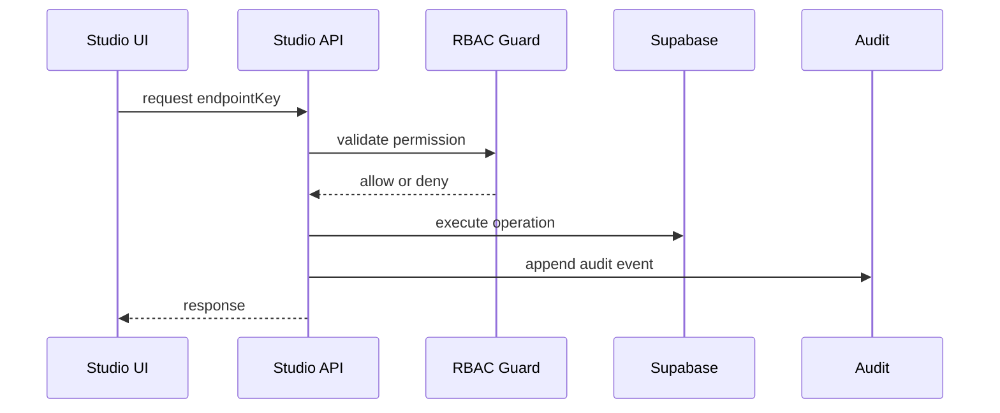

# TS Studio API

As APIs do TS Studio nesta Sprint sao contratos, nao endpoints executaveis. Elas definem superficie, permissao e auditoria esperada para as proximas Sprints.

Fonte: `src/studio/api/contracts.ts`

## Principios

- Toda API declara modulo dono.
- Toda API declara permissao exigida.
- Toda API que altera estado declara `auditAction`.
- Nenhuma API aceita acesso anonimo.
- Nenhuma API deve retornar segredo.
- APIs que tocam comentarios usam o projeto Supabase Comentarios.
- APIs que tocam conteudo, media, settings e audit usam Supabase Principal.

## Endpoints Contratuais

| Key | Metodo | Path | Permissao | Auditoria |
| --- | --- | --- | --- | --- |
| `dashboard.summary` | GET | `/api/studio/dashboard/summary` | `dashboard.read` | nao |
| `content.list` | GET | `/api/studio/content` | `content.read` | nao |
| `content.write` | POST | `/api/studio/content` | `content.write` | `content.create` |
| `content.publish` | POST | `/api/studio/content/:id/publish` | `content.publish` | `content.publish` |
| `media.write` | POST | `/api/studio/media` | `media.write` | `media.register` |
| `discord.moderate` | POST | `/api/studio/discord/comments/:id/moderate` | `discord.moderate` | `discord.comment.moderate` |
| `security.audit` | GET | `/api/studio/security/audit-events` | `security.read` | nao |

## Contrato de Request

```ts
interface StudioApiRequest<TBody = Record<string, unknown>> {
  endpointKey: string;
  actorId: string;
  requestId: string;
  body?: TBody;
}
```

## Contrato de Response

```ts
interface StudioApiResponse<TData = unknown> {
  ok: boolean;
  data?: TData;
  error?: {
    code: string;
    message: string;
  };
}
```

## Fluxo de Autorizacao Futuro



## Erros Padronizados

- `studio.endpoint_unknown`
- `studio.auth_required`
- `studio.permission_denied`
- `studio.validation_failed`
- `studio.conflict`
- `studio.provider_unavailable`
- `studio.audit_failed`

## Pendencias para Sprint 5

- Definir runtime das APIs.
- Decidir se as APIs vivem em Vercel Functions, Supabase Edge Functions ou abordagem hibrida.
- Implementar autenticacao admin.
- Implementar persistencia real de audit events.
- Adicionar testes de permissao por endpoint.
