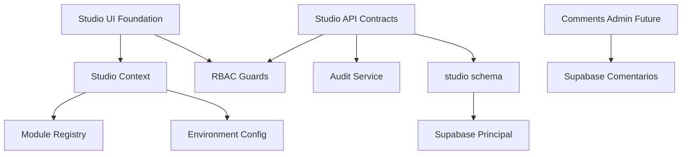

# TS Studio Architecture

Data: 2026-07-08

O TS Studio e a futura camada administrativa do site Talisson Souza. A Sprint 4 implementa somente a fundacao arquitetural: diretorios, contratos, registry de modulos, RBAC, configuracao, servicos base, migracao local e documentacao. O painel nao foi conectado as rotas publicas e nao altera comportamento de producao.

## Camadas

## Separacao do Site Publico

`src/studio` nao importa `src/components`, `src/pages`, `src/data`, `src/integrations` ou `src/contexts`. Essa regra evita acoplamento com a aplicacao publica. O auditor `npm run audit:ts-studio` falha caso uma importacao legada seja introduzida.

## Separacao Supabase

O CMS reconhece dois dominios:

- Supabase Principal: conteudo, contato, newsletter, storage e schema privado `studio`.
- Supabase Comentarios: Discord OAuth, comentarios, reacoes, perfis e Realtime.

O schema `studio` foi criado no projeto Principal porque administra o site como plataforma. Ele nao substitui o projeto Comentarios e nao centraliza dados de comentarios no banco principal.

## Fluxo Futuro de Operacao

1. Usuario interno autentica.
2. API Studio valida sessao.
3. Guard RBAC verifica permissao.
4. Servico executa operacao no dominio correto.
5. Operacao grava `studio.audit_events`.
6. UI atualiza estado por cache/query.

## Ambientes

Os ambientes reconhecidos sao `development`, `preview`, `staging` e `production`. A funcao `resolveStudioEnvironment` falha quando nao recebe ambiente explicito. Essa decisao preserva a regra: Preview e Staging nunca podem usar producao automaticamente.

## Componentes Criados

- `StudioProvider`
- `StudioContext`
- `StudioShell`
- `ModuleCard`
- `StudioDashboardPage`
- `StudioModulePage`

Esses componentes sao fundacionais. Eles existem para validar contratos e orientar a implementacao futura, nao para ativar painel publico nesta Sprint.

## Servicos Criados

- Audit service com redacao de metadados sensiveis.
- Logger em memoria para contratos futuros.
- Session store em memoria para testes e composicao.
- API client contratual que rejeita endpoints desconhecidos.

## Riscos Conhecidos

- O painel ainda nao possui autenticacao real.
- APIs sao contratos, nao endpoints executaveis.
- A migration local ainda nao foi aplicada em staging.
- A UI base nao deve ser adicionada a `App.tsx` antes da Sprint de autenticacao.

## Criterio de Pronto

O TS Studio esta pronto para receber funcionalidade quando:

- `npm run audit:ts-studio` passa;
- `npm run typecheck` passa;
- `npm run build` passa;
- migration local revisada;
- RBAC validado;
- nenhuma importacao legada em `src/studio`;
- nenhuma variavel de producao hardcoded.
