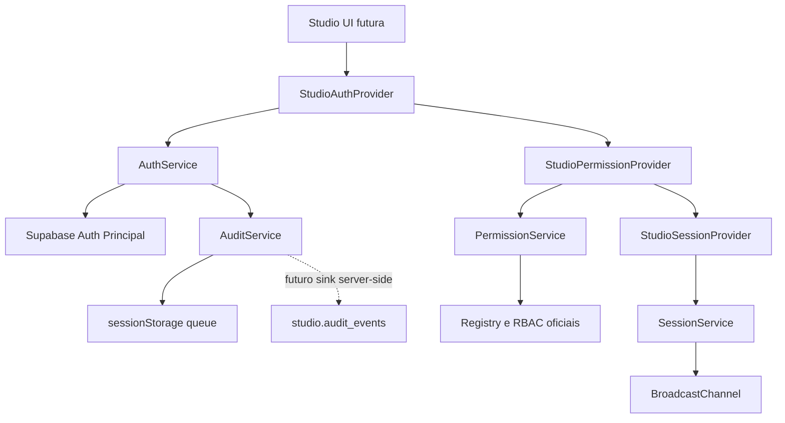

# TS Studio Milestone 1 Auth Report

Data: 2026-07-09
Branch: `feature/ts-studio-milestone-0-foundation-parity`
Status: implementada localmente, sem merge, sem producao

## Objetivo

Implementar a fundacao de autenticacao administrativa do TS Studio para que os modulos futuros usem o mesmo sistema de login, sessao, RBAC, guards, providers, services e auditoria.

## O que foi implementado

### Login administrativo

Foi criado `AuthService` com login por email e senha usando Supabase Auth do Supabase Principal. O fluxo Discord dos comentarios nao e importado nem referenciado.

### Sessao

Foi criado `SessionService` com:

- criacao de `StudioUserSession`;
- expiracao por token, idle timeout e absolute timeout;
- refresh automatico quando a sessao se aproxima do vencimento;
- invalidacao por logout;
- sincronizacao entre abas via `BroadcastChannel`;
- recuperacao de sessao via Supabase Auth.

### Route guards

Foram criados:

- `AuthGuard`
- `RoleGuard`
- `PermissionGuard`
- `ModuleGuard`

Nenhum deles foi conectado ao `App.tsx`; portanto nenhuma rota publica mudou.

### RBAC

O RBAC usa o registry oficial:

- `STUDIO_MODULES`
- `STUDIO_PERMISSIONS`
- `STUDIO_ROLES`

`PermissionService` valida permissoes contra `isStudioPermissionKey`, resolve roles conhecidas e registra `permission_denied` quando uma permissao obrigatoria falha.

### Providers

Foram criados:

- `StudioAuthProvider`
- `StudioPermissionProvider`
- `StudioSessionProvider`

Eles podem ser compostos quando `/studio/*` for ativado, sem alterar paginas publicas.

### Hooks

Foram criados:

- `useStudioAuth`
- `useStudioSession`
- `useRequirePermission`
- `useRequireRole`
- `useStudioUser`

`useStudioPermissions` foi atualizado para usar o novo permission context quando presente e manter fallback compativel com a fundacao anterior.

### API interna

Foram separados contratos em:

- `src/studio/api/queries.ts`
- `src/studio/api/commands.ts`
- `src/studio/api/mutations.ts`

Esses contratos preparam a futura API server-side.

### Auditoria

Foi criado `AuditService` com fila local em `sessionStorage` e sink injetavel. A migration prepara `studio.audit_events` para policy de `service_role`.

### Banco

Foi criada migration local:

`supabase/projects/main/migrations/20260709150000_ts_studio_auth_foundation.sql`

Ela cria:

- `studio.admin_sessions`
- `studio.admin_login_attempts`
- `studio.admin_session_nonces`
- `studio.admin_auth_rate_limits`

Todas as tabelas possuem RLS, FORCE RLS, policies para `service_role`, indices e revogacao de `anon` e `authenticated`.

## Arquitetura final

## Decisoes tomadas

- O login admin usa Supabase Principal, nao Supabase Comentarios.
- `sessionStorage` foi mantido para reduzir persistencia longa de tokens.
- Logout usa escopo global para invalidacao forte.
- O schema `studio` continua privado para browser.
- Repositories e sinks sao injetaveis para a futura API server-side.
- Nenhuma rota `/studio/*` foi ligada ao app publico nesta milestone.

## Riscos

- Roles reais ainda dependem de API server-side futura.
- A fila local de auditoria nao substitui persistencia definitiva.
- A migration precisa de replay em banco limpo antes de Staging.
- O login visual ainda nao foi conectado porque a rota `/studio` permanece desativada por seguranca.

## Impactos

Publico: sem impacto esperado.

SEO: sem impacto, nenhuma rota publica ou metadata foi alterada.

UX: sem impacto publico.

Performance: sem impacto runtime no site publico, pois `src/studio` nao e importado pelo `App.tsx`.

Seguranca: melhora estrutural para proximas milestones.

## Cobertura de RBAC

- Roles oficiais validadas.
- Permissoes validadas contra registry.
- Guards por auth, role, permission e module.
- Denials auditaveis.
- Owner preserva wildcard.

## Cobertura de autenticacao

- login;
- logout;
- refresh;
- recover;
- expiracao;
- invalidacao;
- multi-abas;
- CSRF;
- origem;
- replay;
- rate limit preparado.

## Validacoes executadas

- `npm run lint`: aprovado, com 15 warnings preexistentes fora da Milestone 1.
- `npm run typecheck`: aprovado.
- `npm run build`: aprovado com variaveis Supabase explicitas.
- `npm run audit`: aprovado.
- `npm run audit:auth`: aprovado.
- `npm run audit:ts-studio`: aprovado.
- `npm run audit:edge-functions`: aprovado, executando `deno check` nas Edge Functions existentes.
- `git diff --check`: aprovado.

## Proximos passos para Milestone 2

1. Implementar API server-side real para resolver `studio.user_roles`.
2. Persistir `studio.admin_sessions`.
3. Persistir tentativas em `studio.admin_login_attempts`.
4. Criar tela de Users and RBAC.
5. Bloquear remocao do ultimo owner.
6. Criar revisao de acesso.
7. Validar tudo em Staging antes de qualquer merge.
