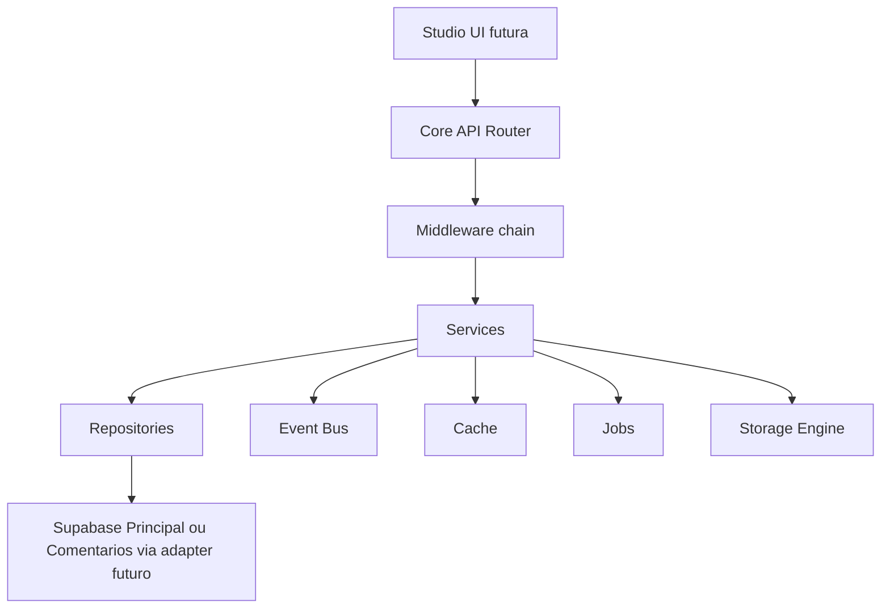

# TS Studio Backend

Data: 2026-07-09
Status: fundacao backend criada na Milestone 2

O backend do TS Studio passa a ter uma arquitetura por camadas. A Milestone 2 nao cria funcionalidades administrativas novas. Ela cria o esqueleto de execucao seguro para que os modulos sejam implementados sem acessar Supabase diretamente e sem repetir autorizacao.

## Camadas

## Responsabilidades

| Camada | Responsabilidade |
| --- | --- |
| Router | Resolver endpoint, contexto, handler e erros |
| Middleware | Segurança, sessao, RBAC, validacao e auditoria |
| Services | Casos de uso de dominio e orquestracao |
| Repositories | Contratos de persistencia |
| Events | Eventos internos e integracoes futuras |
| Cache | Cache local agora, Redis ou outro provider depois |
| Jobs | Fila, retry, dead letter, scheduler e worker como contrato |
| Storage | Upload intent e validacao por provider |
| Config | Ambiente, origens, timeouts, rate limits e flags |

## Services disponiveis

- AuthService
- SessionService
- PermissionService
- RoleService
- UserService
- ModuleService
- SettingsService
- StorageService
- MediaService
- AuditService
- LogService
- AnalyticsService
- MonitoringService
- NotificationService
- EventService
- JobService
- PluginService
- FeatureFlagService
- ConfigService
- CacheService
- DiscordService
- SEOService
- NewsletterService
- FormService

## Repositories disponiveis

- UserRepository
- SettingsRepository
- ArticleRepository
- MediaRepository
- CommentRepository
- AuditRepository
- AnalyticsRepository
- RoleRepository
- PermissionRepository
- ModuleRepository

## Decisoes

1. Services nao acessam Supabase diretamente.
2. Repositories sao interfaces, com implementacao em memoria para testes estruturais.
3. Storage e adapter, nao dependencia direta.
4. Feature flags sao avaliadas por service central.
5. Jobs ainda nao executam trabalho real.
6. Plugins possuem registry, mas nao carregam codigo externo.

## Impacto

Nao ha alteracao de comportamento publico. A mudanca prepara o backend administrativo para evoluir por modulo.
