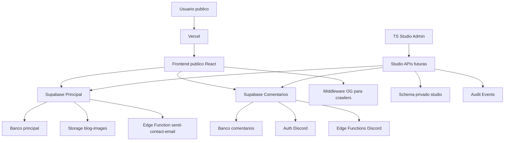

# TS Studio Blueprint

Data: 2026-07-08

Este documento transforma a engenharia reversa do site Talisson Souza em um blueprint de CMS profissional. O TS Studio sera o painel administrativo responsavel por operar conteudo, comunidade, SEO, formularios, midia, integracoes, seguranca, auditoria e infraestrutura, mantendo separacao entre a aplicacao publica e os ambientes internos.

O objetivo desta Sprint nao e criar todas as telas finais. O objetivo e definir exatamente o que o CMS sera capaz de administrar, quais modulos existem, quais dados cada modulo controla, quais permissoes serao necessarias e quais riscos precisam ser tratados antes de ativar funcionalidades em producao.

## Principios

1. O site publico continua desacoplado do painel administrativo.
2. Nenhum ambiente pode cair automaticamente em recursos de producao.
3. Supabase Principal e Supabase Comentarios permanecem separados.
4. O schema `studio` e privado e nao deve ser acessado diretamente pelo browser.
5. Toda operacao administrativa futura deve gerar evento de auditoria.
6. RBAC e requisito de arquitetura, nao uma camada opcional.
7. Conteudo, SEO, Open Graph e Schema.org devem ser tratados como dados versionados.
8. Integracoes externas devem ter inventario, status, secrets esperados e health check.
9. Uploads devem ser governados por MIME type, tamanho, ownership, alt text e revisao.
10. O CMS deve ser preparado para plugins, mas nenhum plugin pode herdar permissao automaticamente.

## Arquitetura Alvo

## Superficie Administravel

O TS Studio deve administrar:

- paginas institucionais, artigos, trilhas, tags, categorias, checklists, politicas e paginas de servico;
- SEO, canonical, Open Graph, Twitter Cards, JSON-LD, sitemap, robots e manifest;
- biblioteca de arquivos, imagens, videos, PDFs e assets publicos;
- comentarios, reacoes, moderacao, badges, perfis Discord e fluxo OAuth;
- formulario de contato, CAPTCHA, rate limit, Resend, leads e emails;
- newsletter, consentimento, segmentacao e campanhas futuras;
- usuarios internos, papeis, permissoes e ciclo de acesso;
- Supabase Principal, Supabase Comentarios, Edge Functions, Storage, RLS, Realtime e RPC;
- Vercel, GitHub, Cloudflare, Hostinger, Discord, Google, Spotify, Mercado Pago e Resend como integracoes;
- logs, auditoria, jobs, filas, monitoramento, backups, recovery e configuracoes globais;
- menus, navbar, footer, hero, widgets, blocos, landing pages e tema.

## Catalogo de Modulos

### Dashboard

Objetivo: oferecer uma visao operacional do estado do site, conteudo, comunidade, seguranca, formularios, SEO, deploy e integracoes.

Funcionalidades:

- cards de saude por area;
- pendencias de revisao editorial;
- ultimos eventos de auditoria;
- status de Vercel, Supabase, Edge Functions e comentarios;
- alertas de SEO, sitemap, robots e Open Graph;
- indicadores de comentarios, formularios e newsletter.

Telas previstas: visao geral, atividade recente, alertas, tarefas, deploy e integracoes.

Permissoes: `dashboard.read`.

Banco: `studio.audit_events`, `studio.jobs`, `studio.integration_connections`.

APIs: `GET /api/studio/dashboard/summary`.

Componentes: cards de modulo, feed de eventos, painel de status, filtros por ambiente.

Integracoes: Vercel, Supabase, GitHub, Discord, Resend.

Eventos e auditoria: acesso ao dashboard, reconhecimento de alerta, mudanca de status operacional.

Dependencias: Monitoramento, Seguranca, Integracoes.

Riscos: metricas incompletas, excesso de ruido, leitura por usuario sem permissao.

Impacto: melhora tomada de decisao e reduz tempo para identificar regressao.

### Conteudo

Objetivo: centralizar a gestao de todo conteudo editorial e institucional do site.

Funcionalidades:

- criacao de rascunhos;
- edicao bilingue;
- versionamento;
- workflow de revisao;
- publicacao programada;
- arquivo e restauracao;
- relacionamento com tags, categorias, autores, midia e SEO.

Telas previstas: lista de conteudos, editor, historico de versoes, revisao, agenda editorial.

Permissoes: `content.read`, `content.write`, `content.publish`.

Banco: `studio.content_items`, `studio.content_versions`.

APIs: `GET /api/studio/content`, `POST /api/studio/content`, `POST /api/studio/content/:id/publish`.

Componentes: editor, seletor de idioma, diffs de versao, preview, status badge.

Integracoes: React Router, sitemap, middleware OG, Helmet.

Eventos e auditoria: criar, editar, enviar para revisao, publicar, arquivar, restaurar.

Dependencias: Midia, SEO, Autores, Taxonomia.

Riscos: publicar conteudo incorreto, quebrar slug, duplicar canonical, perder historico.

Impacto: transforma o site em plataforma editorial controlada.

### Artigos

Objetivo: administrar artigos longos, trilhas de conteudo, fontes, tags, leitura relacionada e SEO editorial.

Funcionalidades:

- cadastro de titulo PT/EN;
- slug PT/EN;
- resumo, tempo de leitura, keywords e fonte;
- secoes estruturadas;
- relacao com trilhas;
- artigos relacionados;
- validação de canonical e sitemap.

Telas previstas: artigos, editor de secoes, fontes, trail linking, SEO editorial.

Permissoes: `articles.read`, `articles.write`, `articles.publish`.

Banco: `studio.content_items`, `studio.content_versions`.

APIs: herdam contratos de Conteudo.

Componentes: editor de artigo, preview de SEO, organizador de secoes, seletor de trilha.

Integracoes: `src/data/market-trail`, `src/data/articles.ts`, middleware OG, sitemap.

Eventos e auditoria: criar artigo, alterar slug, publicar, atualizar fonte, mudar trilha.

Dependencias: Conteudo, SEO, Taxonomia, Autores.

Riscos: artigo em bundle crescer demais, metadados divergentes entre SPA e middleware, fonte ausente.

Impacto: permite evoluir a aba Artigos sem editar arquivos manualmente no futuro.

### Categorias e Tags

Objetivo: organizar conteudos por assunto, trilha, nivel de maturidade e intencao de busca.

Funcionalidades: criar tags, agrupar categorias, mapear slugs bilingues, detectar tags orfas, unir duplicatas.

Telas previstas: taxonomia, tag detail, relatorio de uso, merge de tags.

Permissoes: `taxonomy.read`, `taxonomy.write`.

Banco: inicialmente `studio.content_items`; futuro `studio.taxonomies`.

APIs: futuras em `/api/studio/taxonomy`.

Componentes: arvore de categorias, contador de conteudos, editor de alias.

Integracoes: paginas `/artigos/tag/:tag`, trilhas, SEO.

Eventos e auditoria: criar, renomear, unir, arquivar tag.

Dependencias: Conteudo e SEO.

Riscos: quebrar rotas antigas, perder ranqueamento por URL, criar taxonomia confusa.

Impacto: melhora descoberta de conteudo e estrutura editorial.

### Autores

Objetivo: preparar suporte para multiplos autores, bios, redes sociais, autoridade editorial e Schema.org.

Funcionalidades: perfil de autor, foto, bio PT/EN, links, areas de especialidade, historico de artigos.

Telas previstas: autores, perfil, artigos por autor, revisoes.

Permissoes: `authors.read`, `authors.write`.

Banco: `studio.content_items`, `studio.user_roles`; futuro `studio.authors`.

APIs: futuras em `/api/studio/authors`.

Componentes: author card, editor de bio, seletor de byline.

Integracoes: SEO, Article schema, componentes de cabecalho de artigo.

Eventos e auditoria: criar autor, alterar bio, trocar foto, vincular artigo.

Dependencias: Usuarios, Midia, SEO.

Riscos: autoria incorreta, schema inconsistente, uso de imagem sem alt.

Impacto: prepara o site para operacao editorial profissional.

### SEO, Open Graph e Schema.org

Objetivo: governar metadados de busca, redes sociais e crawlers sem divergencia entre frontend, middleware e sitemap.

Funcionalidades:

- title e meta description;
- canonical;
- og:title, og:description, og:type, og:image;
- Twitter Card;
- Schema.org Article, WebSite, Breadcrumb e Organization;
- validacao de sitemap e robots;
- preview por rota.

Telas previstas: SEO overview, rota detail, preview social, schema validator, sitemap manager.

Permissoes: `seo.read`, `seo.write`, `seo.manage`.

Banco: `studio.content_items.seo`, `studio.content_items.og`, `studio.content_items.schema_json`, `studio.settings`.

APIs: futuras em `/api/studio/seo`.

Componentes: SEO preview, OG preview, canonical checker, JSON-LD editor.

Integracoes: `react-helmet-async`, `middleware.ts`, `public/sitemap.xml`, `public/robots.txt`.

Eventos e auditoria: alterar canonical, trocar og:image, publicar schema, atualizar sitemap.

Dependencias: Conteudo, Midia, Sistema.

Riscos: crawler receber metadado diferente do usuario, canonical duplicado, sitemap obsoleto.

Impacto: aumenta confiabilidade de indexacao e compartilhamento social.

### Uploads e Biblioteca de Arquivos

Objetivo: administrar imagens, videos, PDFs e assets com metadados, permissoes e seguranca.

Funcionalidades: upload, renomeacao logica, alt text, MIME allowlist, limite de tamanho, owner folder, substituicao controlada, arquivamento.

Telas previstas: biblioteca, upload, asset detail, uso do asset, pendencias de alt text.

Permissoes: `media.read`, `media.write`, `media.manage`.

Banco: `studio.media_assets`, `storage.objects`.

APIs: futura assinatura de upload e registro em `/api/studio/media`.

Componentes: grid de midia, seletor de asset, preview, painel de metadados.

Integracoes: Supabase Storage, bucket `blog-images`, componentes de artigo e paginas.

Eventos e auditoria: upload, substituir, deletar, alterar alt, vincular a conteudo.

Dependencias: Conteudo, SEO, Seguranca.

Riscos: upload malicioso, arquivo grande demais, exposicao publica indevida, falta de acessibilidade.

Impacto: reduz dependencia de edicao manual de assets.

### Usuarios, Perfis, Papeis e Permissoes

Objetivo: controlar acesso administrativo com RBAC explicito.

Funcionalidades: papeis, permissoes, atribuicoes, expiracao de acesso, revisao de acessos, trilha de auditoria.

Telas previstas: usuarios, papeis, matriz de permissoes, revisao de acesso.

Permissoes: `users.read`, `users.manage`.

Banco: `studio.roles`, `studio.permissions`, `studio.role_permissions`, `studio.user_roles`.

APIs: futuras em `/api/studio/users` e `/api/studio/rbac`.

Componentes: role matrix, permission gate, user access table.

Integracoes: Supabase Auth.

Eventos e auditoria: atribuir papel, remover papel, expirar acesso, alterar permissao.

Dependencias: Seguranca e Auditoria.

Riscos: escalada de privilegio, ex-funcionario com acesso, permissao ampla demais.

Impacto: viabiliza administracao profissional com least privilege.

### Discord, Comentarios e Moderacao

Objetivo: operar a camada de comunidade conectada ao Discord e aos comentarios dos artigos.

Funcionalidades: login Discord, perfis, comentarios, respostas, reacoes, badges verificados, moderacao, sync de perfil, leitura de Realtime.

Telas previstas: comentarios, fila de moderacao, usuarios Discord, eventos OAuth, comentarios por artigo.

Permissoes: `discord.read`, `discord.moderate`, `discord.manage`.

Banco: projeto Comentarios, tabelas `comments`, `comment_reactions`, `discord_profiles`, `user_roles`.

APIs: Edge Functions `discord-post-login`, `discord-refresh-profile`, `discord-userinfo`; futuras APIs admin.

Componentes: fila de moderacao, comment detail, perfil Discord, badge reviewer.

Integracoes: Supabase Comentarios, Discord OAuth, Discord Bot API, Realtime.

Eventos e auditoria: ocultar comentario, restaurar, banir, atualizar perfil, falha OAuth.

Dependencias: Usuarios, Seguranca, Monitoramento.

Riscos: abuso, spam, vazamento de provider token, callbacks incorretos, notificacoes excessivas.

Impacto: protege a comunidade e melhora confianca nos artigos.

### Formularios, Contato e Emails

Objetivo: controlar a entrada de leads e mensagens com anti-abuso, roteamento e email.

Funcionalidades: configuracao de assunto, campos, CAPTCHA, rate limit, honeypot, envio via Resend, logs e retencao.

Telas previstas: submissions, configuracao do formulario, rate limit, email templates.

Permissoes: `forms.read`, `forms.manage`.

Banco: `public.contact_rate_limits`, `studio.audit_events`; futuro `studio.form_submissions` se houver persistencia.

APIs: Edge Function `send-contact-email`.

Componentes: submission table, config form, email status.

Integracoes: Supabase Principal, Resend.

Eventos e auditoria: envio aceito, envio bloqueado, captcha falho, rate limit atingido.

Dependencias: Seguranca, Integracoes.

Riscos: spam, PII em logs, falha de segredo, excesso de retencao.

Impacto: melhora confiabilidade do canal comercial.

### Newsletter

Objetivo: preparar gestao de assinantes, consentimento e campanhas.

Funcionalidades: inscricao, opt-in, unsubscribe, segmento, status, importacao futura, campanha futura.

Telas previstas: assinantes, segmentos, consentimento, campanhas.

Permissoes: `newsletter.read`, `newsletter.write`, `newsletter.manage`.

Banco: `public.newsletter_subscribers`; futuro `studio.newsletter_segments`.

APIs: futuras em `/api/studio/newsletter`.

Componentes: subscriber list, consent detail, segment builder.

Integracoes: Resend.

Eventos e auditoria: inscrever, descadastrar, alterar consentimento, exportar.

Dependencias: Forms, Emails, Seguranca.

Riscos: LGPD, spam, exportacao indevida, consentimento mal registrado.

Impacto: permite relacionamento recorrente com audiencia.

### Analytics e Atividade

Objetivo: medir engajamento, conteudo, comunidade, busca e conversao sem expor dados pessoais desnecessarios.

Funcionalidades: views por rota, artigos mais lidos, comentarios por artigo, leads, tendencias, funil de conteudo.

Telas previstas: analytics overview, conteudo, comunidade, SEO, formularios.

Permissoes: `analytics.read`.

Banco: `studio.audit_events`, dados agregados de comentarios e forms.

APIs: futuras em `/api/studio/analytics`.

Componentes: charts, scorecards, tabelas exploraveis.

Integracoes: Vercel Analytics, Google Search Console, Supabase.

Eventos e auditoria: exportar relatorio, alterar janela, criar anotacao.

Dependencias: Conteudo, Discord, Forms.

Riscos: metricas inconsistentes, PII em dashboards, analise sem contexto.

Impacto: melhora decisoes editoriais e comerciais.

### Monitoramento, Logs e Alertas

Objetivo: acompanhar saude de deploy, Edge Functions, runtime, integracoes e jobs.

Funcionalidades: erro por ambiente, status de deploy, health checks, logs filtrados, alertas, historico de incidentes.

Telas previstas: runtime, deploys, Edge Functions, incidentes, alertas.

Permissoes: `monitoring.read`, `monitoring.manage`.

Banco: `studio.jobs`, `studio.integration_connections`, `studio.audit_events`.

APIs: futuras em `/api/studio/monitoring`.

Componentes: status cards, log viewer, incident timeline.

Integracoes: Vercel Logs, Supabase Logs, GitHub Checks.

Eventos e auditoria: reconhecer alerta, abrir incidente, fechar incidente.

Dependencias: Integracoes, Seguranca.

Riscos: logs insuficientes, alerta falso, falha silenciosa.

Impacto: reduz tempo de deteccao e recuperacao.

### Seguranca, Auditoria e Hardening

Objetivo: centralizar postura de seguranca do CMS, site e infraestrutura.

Funcionalidades: audit trail, secrets inventory, RBAC review, security headers, CSP, RLS status, policies, storage checks.

Telas previstas: postura, auditoria, permissoes, secrets, headers, Supabase checks.

Permissoes: `security.read`, `security.manage`, `security.audit`.

Banco: `studio.audit_events`, `studio.roles`, `studio.permissions`.

APIs: `GET /api/studio/security/audit-events` e futuras APIs de health.

Componentes: audit table, policy status, permission diff.

Integracoes: Supabase Advisors, Vercel config, GitHub Security.

Eventos e auditoria: qualquer acao sensivel, mudanca de permissao, alteracao de integracao.

Dependencias: Usuarios, Integracoes.

Riscos: auditoria incompleta, permissao excessiva, segredo em ambiente errado.

Impacto: reduz risco operacional antes de escalar o painel.

### Integracoes

Objetivo: manter inventario e estado de provedores externos.

Funcionalidades: status, ambiente, owner, secrets esperados, callback, origem permitida, health check.

Telas previstas: integracoes, detalhe do provedor, checklist, historico de falhas.

Permissoes: `integrations.read`, `integrations.manage`.

Banco: `studio.integration_connections`, `studio.settings`.

APIs: futuras em `/api/studio/integrations`.

Componentes: provider card, health badge, secret checklist.

Integracoes: Supabase, Vercel, Discord, Resend, GitHub, Cloudflare, Hostinger, Mercado Pago, Spotify, Google.

Eventos e auditoria: alterar config, marcar health check, atualizar callback.

Dependencias: Seguranca, Monitoramento.

Riscos: usar ambiente errado, callback inconsistente, secret ausente.

Impacto: reduz regressao em OAuth, deploy e email.

### Sistema, Tema, Layout, Menus e Widgets

Objetivo: preparar o CMS para administrar configuracoes globais e elementos estruturais do site.

Funcionalidades: menus, navbar, footer, hero, tema, landing pages, widgets, blocos, feature flags, configuracoes por ambiente.

Telas previstas: settings, menus, layout, feature flags, ambientes.

Permissoes: `system.read`, `system.manage`.

Banco: `studio.settings`, `studio.feature_flags`.

APIs: futuras em `/api/studio/system`.

Componentes: settings form, menu builder, flag editor.

Integracoes: frontend publico, Vercel env, Supabase config.

Eventos e auditoria: ativar flag, alterar menu, alterar tema, alterar configuracao global.

Dependencias: Seguranca, Conteudo, Integracoes.

Riscos: alteracao quebrar navegacao, flag em ambiente errado, fallback para producao.

Impacto: permite evoluir o site sem editar layout manualmente.

## Modulos Futuros

Mercado Pago: pagamentos, produtos, assinaturas, webhooks, reconciliacao e antifraude.

Spotify: embeds, playlists, integracao de conteudo e status de API.

Google: Search Console, Analytics, indexacao, rich results e consentimento.

RSS e PWA: feeds, manifest, service worker, cache e invalidacao.

Plugins: registro, permissoes isoladas, configuracao, auditoria e rollout.

Backups e Disaster Recovery: snapshots, restore drill, rollback de migration, runbooks e RTO/RPO.

## Regras de Nao Regressao

- Nenhum modulo do TS Studio deve ser importado pelo site publico ate a Sprint de ativacao.
- Nenhum segredo pode ser colocado em variavel `VITE_*`.
- Nenhum cliente browser pode acessar diretamente o schema `studio`.
- Nenhum modulo pode assumir producao como fallback.
- Toda rota, API e job futuro deve declarar permissao exigida.
- Toda operacao que altera estado deve declarar evento de auditoria.

## Resultado Esperado

Ao final da Sprint 4, o TS Studio ainda nao e um painel funcional completo. Ele passa a ser uma fundacao profissional, modular, auditavel e preparada para receber telas, APIs reais, workflows editoriais, moderacao, analytics e automacoes nas Sprints seguintes.
