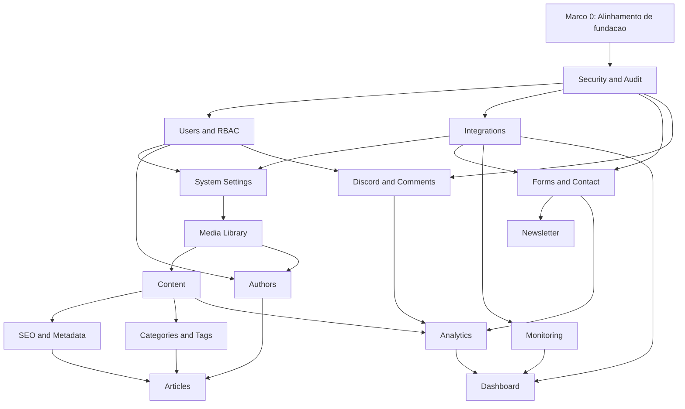

# TS Studio Implementation Plan

Data: 2026-07-09

Este documento faz a engenharia reversa do blueprint, da fundacao em `src/studio`, dos contratos de API, do RBAC e das migrations Supabase ja existentes. O objetivo e transformar o TS Studio em um plano tecnico implementavel, ordenado por dependencia, com modulos independentes o suficiente para evoluir sem retrabalho e sem acoplamento desnecessario com o site publico.

## Escopo analisado

Fontes principais:

- `docs/ts-studio-blueprint.md`
- `docs/ts-studio-architecture.md`
- `docs/ts-studio-modules.md`
- `docs/ts-studio-api.md`
- `docs/ts-studio-rbac.md`
- `docs/ts-studio-database.md`
- `src/studio/modules/registry.ts`
- `src/studio/permissions/rbac.ts`
- `src/studio/api/contracts.ts`
- `supabase/projects/main/migrations/20260708205740_ts_studio_foundation.sql`
- migrations do Supabase Principal e Supabase Comentarios

## Regras arquiteturais que guiam o roadmap

1. O TS Studio nao deve importar codigo do site publico ate a sprint de ativacao.
2. O site publico nao deve importar `src/studio` ate existir autenticacao, autorizacao e rotas protegidas.
3. O schema `studio` deve continuar privado e fora do acesso direto de browser.
4. Toda API administrativa deve validar sessao, ambiente explicito e permissao RBAC no servidor.
5. Toda operacao de escrita deve gerar evento em `studio.audit_events`.
6. Supabase Principal e Supabase Comentarios continuam separados.
7. Preview e Staging nunca podem usar Production como fallback.
8. Cada modulo deve ter testes, contratos, permissao e eventos proprios antes de depender de outro modulo.
9. Dashboard e Analytics devem ser consumidores tardios, nao fontes primarias de regras de negocio.
10. Integracoes externas devem ser declaradas, auditadas e testadas por health checks isolados.

## Estado identificado antes da Milestone 0

O registry TypeScript possui 16 modulos:

1. `dashboard`
2. `content`
3. `articles`
4. `taxonomy`
5. `authors`
6. `seo`
7. `media`
8. `users`
9. `discord`
10. `forms`
11. `newsletter`
12. `analytics`
13. `monitoring`
14. `security`
15. `integrations`
16. `system`

A migration inicial do schema `studio` semeava 13 modulos. Faltavam no seed SQL:

- `articles`
- `taxonomy`
- `authors`

Permissoes existentes no TypeScript, mas ainda ausentes no seed SQL inicial:

- `articles.read`
- `articles.write`
- `articles.publish`
- `taxonomy.read`
- `taxonomy.write`
- `authors.read`
- `authors.write`
- `seo.read`
- `seo.write`
- `media.manage`
- `users.audit`
- `discord.manage`
- `newsletter.read`
- `newsletter.write`
- `monitoring.manage`
- `security.audit`
- `system.read`

Este desalinhamento nao quebrava a fundacao original porque as APIs ainda eram contratuais, mas precisava ser resolvido antes da primeira API real do Studio.

## Estado apos a Milestone 0

A Milestone 0 corrigiu a paridade entre registry TypeScript, RBAC TypeScript e migration SQL:

- o seed de `studio.modules` possui os 16 modulos oficiais;
- `studio.module_dependencies` possui seed alinhado com `src/studio/modules/registry.ts`;
- `studio.permissions` possui todas as permissoes declaradas no registry;
- `studio.role_permissions` foi realinhada com `src/studio/permissions/rbac.ts`;
- `npm run audit:ts-studio` falha se houver divergencia futura entre registry, RBAC e SQL.

## Decisao tecnica recomendada para APIs

Para o roadmap abaixo, a recomendacao e implementar as APIs do TS Studio como backend server-side no hosting da aplicacao, preferencialmente em Vercel Functions ou camada equivalente, mantendo Supabase Edge Functions apenas para fluxos ja especificos de Supabase, Discord e email.

Motivo:

- o painel sera servido junto da aplicacao;
- o Studio precisa orquestrar Supabase Principal, Supabase Comentarios, Vercel, GitHub, Resend e futuros provedores;
- service role nunca pode chegar ao browser;
- RBAC deve ser aplicado antes de qualquer query administrativa;
- logs, request id e rate limit ficam mais faceis de padronizar em uma unica camada.

Se no futuro houver jobs longos, webhooks ou tarefas agendadas, esses fluxos podem ser movidos para Supabase Edge Functions ou filas dedicadas, desde que continuem chamando a mesma camada de permissao e auditoria.

## Ordem tecnica por dependencia

## Marco 0 - Alinhamento de fundacao

Objetivo: eliminar divergencias entre blueprint, registry, RBAC e migration antes de qualquer tela funcional.

Status: concluido na branch `feature/ts-studio-milestone-0-foundation-parity`.

Pre-requisitos:

- branch de trabalho isolada;
- migration de fundacao revisada em staging;
- decisao sobre runtime das APIs Studio;
- estrategia de autenticacao administrativa definida.

Tabelas:

- `studio.modules`
- `studio.permissions`
- `studio.role_permissions`
- `studio.module_dependencies`

APIs:

- nenhuma API publica ainda;
- criar apenas scripts internos de validacao.

Componentes React:

- nenhum componente novo obrigatorio;
- validar `StudioShell`, `ModuleCard`, `StudioDashboardPage` e `StudioModulePage` como placeholders.

Hooks:

- validar `useStudioModules`;
- validar `useStudioPermissions`.

Permissoes RBAC:

- sincronizar TypeScript e SQL;
- adicionar seeds ausentes;
- garantir que `owner` mantenha wildcard e que demais roles recebam apenas permissoes declaradas.

Eventos de auditoria:

- `studio.foundation.validated`
- `studio.rbac.seed_aligned`
- `studio.module_registry.aligned`

Integracoes externas:

- Supabase Principal;
- ambiente de staging.

Riscos:

- criar migration corretiva com seeds incompletos;
- ativar rota antes da paridade RBAC;
- deixar o banco com permissoes que o TypeScript desconhece.

Esforco estimado:

- 1 a 2 dias.

Criterios de conclusao:

- registry e seed SQL possuem os mesmos modulos;
- registry e seed SQL possuem as mesmas permissoes;
- auditoria automatica detecta divergencia futura;
- `npm run audit:ts-studio` continua passando;
- nenhuma rota admin e exposta.

## Modulo 1 - Security and Audit

Objetivo: criar a base server-side para autenticacao administrativa, autorizacao, auditoria e rastreabilidade.

Pre-requisitos:

- Marco 0 concluido;
- runtime das APIs definido;
- schema `studio` aplicado em staging;
- variaveis de ambiente de staging configuradas sem fallback para producao.

Tabelas:

- `studio.audit_events`
- `studio.roles`
- `studio.permissions`
- `studio.role_permissions`
- `studio.user_roles`
- `studio.integration_connections`

APIs:

- `GET /api/studio/security/audit-events`
- `GET /api/studio/security/posture`
- `POST /api/studio/security/audit-events/search`
- `POST /api/studio/security/access-review`

Componentes React:

- `AuditEventTable`
- `SecurityPosturePanel`
- `PermissionDiffViewer`
- `AccessReviewPanel`
- `SensitiveMetadataBadge`

Hooks:

- `useAuditEvents`
- `useSecurityPosture`
- `useAccessReview`
- `useStudioPermissions`

Permissoes RBAC:

- `security.read`
- `security.manage`
- `security.audit`
- `users.audit`

Eventos de auditoria:

- `security.audit.read`
- `security.posture.read`
- `security.access_review.started`
- `security.access_review.completed`
- `security.permission_denied`
- `security.rbac.changed`

Integracoes externas:

- Supabase Principal;
- Supabase Advisors no futuro;
- GitHub Security no futuro;
- Vercel headers no futuro.

Riscos:

- service role exposta por erro de runtime;
- auditoria incompleta em operacoes sensiveis;
- uso de claims inseguras de `user_metadata`;
- leitura ampla demais de eventos;
- logs contendo PII ou secrets.

Esforco estimado:

- 4 a 6 dias.

Criterios de conclusao:

- APIs exigem sessao administrativa;
- toda chamada possui `requestId`;
- negacoes sensiveis sao auditadas;
- metadata sensivel e redigida;
- endpoints de auditoria nao retornam secrets;
- testes cobrem owner, admin, analyst e usuario sem permissao.

## Modulo 2 - Users and RBAC

Objetivo: administrar usuarios internos, roles, permissoes, expiracao de acesso e revisao de acesso.

Pre-requisitos:

- Security and Audit concluido;
- Auth administrativo decidido no Supabase Principal;
- seed RBAC em paridade com TypeScript.

Tabelas:

- `auth.users`
- `studio.roles`
- `studio.permissions`
- `studio.role_permissions`
- `studio.user_roles`
- `studio.audit_events`

APIs:

- `GET /api/studio/users`
- `GET /api/studio/users/:id`
- `POST /api/studio/users/:id/roles`
- `DELETE /api/studio/users/:id/roles/:roleKey`
- `GET /api/studio/rbac/matrix`
- `POST /api/studio/rbac/access-review`

Componentes React:

- `UserAccessTable`
- `RoleMatrix`
- `RoleAssignmentDialog`
- `AccessExpirationField`
- `UserSessionSummary`

Hooks:

- `useStudioUsers`
- `useRoleMatrix`
- `useRoleAssignments`
- `useAccessReview`

Permissoes RBAC:

- `users.read`
- `users.manage`
- `users.audit`
- `security.read`

Eventos de auditoria:

- `users.role.assigned`
- `users.role.removed`
- `users.role.expired`
- `users.access_review.completed`
- `users.permission_matrix.viewed`

Integracoes externas:

- Supabase Auth no projeto Principal.

Riscos:

- escalada de privilegio;
- owner unico sem plano de recuperacao;
- acesso de ex-colaborador sem expiracao;
- role assignment sem justificativa;
- UI permitir remover o ultimo owner.

Esforco estimado:

- 4 a 7 dias.

Criterios de conclusao:

- nenhum usuario recebe role sem auditoria;
- nao e possivel remover o ultimo owner;
- expiracao de acesso e respeitada;
- matriz de permissoes bate com seed SQL;
- testes cobrem assign, remove, expire e denied.

## Modulo 3 - Integrations

Objetivo: manter inventario, status, ambiente, callbacks e secrets esperados para provedores externos.

Pre-requisitos:

- Security and Audit concluido;
- Users and RBAC com `admin` e `owner` funcionais;
- tabela `studio.integration_connections` revisada.

Tabelas:

- `studio.integration_connections`
- `studio.settings`
- `studio.audit_events`

APIs:

- `GET /api/studio/integrations`
- `GET /api/studio/integrations/:key`
- `PATCH /api/studio/integrations/:key`
- `POST /api/studio/integrations/:key/health-check`
- `GET /api/studio/integrations/:key/required-secrets`

Componentes React:

- `IntegrationProviderCard`
- `IntegrationDetailPanel`
- `SecretChecklist`
- `CallbackUrlList`
- `HealthCheckStatus`

Hooks:

- `useIntegrations`
- `useIntegrationHealth`
- `useRequiredSecrets`

Permissoes RBAC:

- `integrations.read`
- `integrations.manage`
- `security.read`

Eventos de auditoria:

- `integrations.config.updated`
- `integrations.health_check.executed`
- `integrations.secret_check.viewed`
- `integrations.callback.updated`

Integracoes externas:

- Supabase Principal;
- Supabase Comentarios;
- Vercel;
- GitHub;
- Discord;
- Resend;
- Cloudflare;
- Hostinger;
- Mercado Pago;
- Spotify;
- Google.

Riscos:

- segredo exibido em UI;
- callback de staging apontando para producao;
- health check com side effect;
- provider marcado como configurado sem secret real;
- divergencia entre Vercel env e Supabase secret.

Esforco estimado:

- 4 a 6 dias.

Criterios de conclusao:

- painel mostra status por ambiente;
- secrets aparecem apenas como presente, ausente ou invalido, nunca em texto claro;
- callbacks sao comparados por ambiente;
- health checks nao alteram dados;
- testes validam ausencia de fallback para producao.

## Modulo 4 - System Settings

Objetivo: administrar configuracoes globais, feature flags, menus futuros, layout e politica de ambiente.

Pre-requisitos:

- Security and Audit concluido;
- Users and RBAC concluido;
- Integrations com ambiente explicito;
- decisao sobre quais settings podem ser publicos.

Tabelas:

- `studio.settings`
- `studio.feature_flags`
- `studio.audit_events`

APIs:

- `GET /api/studio/system/settings`
- `PATCH /api/studio/system/settings/:key`
- `GET /api/studio/system/feature-flags`
- `PATCH /api/studio/system/feature-flags/:key`

Componentes React:

- `SystemSettingsForm`
- `FeatureFlagTable`
- `EnvironmentPolicyPanel`
- `SettingVisibilityBadge`

Hooks:

- `useSystemSettings`
- `useFeatureFlags`
- `useEnvironmentPolicy`

Permissoes RBAC:

- `system.read`
- `system.manage`
- `security.read`

Eventos de auditoria:

- `system.setting.updated`
- `system.feature_flag.enabled`
- `system.feature_flag.disabled`
- `system.environment_policy.changed`

Integracoes externas:

- Vercel env vars;
- Supabase Principal;
- frontend publico no futuro.

Riscos:

- flag ativa em ambiente errado;
- setting privado exposto;
- mudanca quebrar navegacao publica;
- configuracao global virar fonte de regra de negocio oculta.

Esforco estimado:

- 3 a 5 dias.

Criterios de conclusao:

- settings possuem visibilidade `private`, `internal` ou `public`;
- alteracoes geram auditoria com diff;
- feature flag nao cruza ambiente;
- testes cobrem leitura, update, denied e rollback logico.

## Modulo 5 - Media Library

Objetivo: gerenciar assets, metadados, alt text, ownership, MIME type e relacao com conteudo.

Pre-requisitos:

- Security and Audit concluido;
- Users and RBAC concluido;
- System Settings define limites por ambiente;
- bucket `blog-images` revisado em staging.

Tabelas:

- `studio.media_assets`
- `storage.objects`
- `studio.audit_events`

APIs:

- `GET /api/studio/media`
- `POST /api/studio/media/upload-intent`
- `POST /api/studio/media`
- `GET /api/studio/media/:id`
- `PATCH /api/studio/media/:id`
- `POST /api/studio/media/:id/archive`

Componentes React:

- `MediaLibraryGrid`
- `MediaUploadDialog`
- `MediaAssetDetail`
- `AltTextChecklist`
- `AssetUsagePanel`
- `MimeTypeBadge`

Hooks:

- `useMediaAssets`
- `useMediaUpload`
- `useMediaAsset`
- `useAssetUsage`

Permissoes RBAC:

- `media.read`
- `media.write`
- `media.manage`

Eventos de auditoria:

- `media.upload_intent.created`
- `media.asset.registered`
- `media.asset.updated`
- `media.asset.archived`
- `media.alt_text.updated`
- `media.asset.linked`

Integracoes externas:

- Supabase Storage no projeto Principal;
- bucket `blog-images`;
- futura validacao antivirus ou scanner de MIME real.

Riscos:

- upload malicioso;
- public URL indevida;
- arquivo muito grande;
- extensao e MIME divergentes;
- asset usado por conteudo publicado ser removido;
- ausencia de alt text prejudicar acessibilidade e SEO.

Esforco estimado:

- 5 a 8 dias.

Criterios de conclusao:

- upload passa por allowlist de MIME e tamanho;
- asset e registrado em `studio.media_assets`;
- delete fisico nao e permitido no primeiro release, apenas archive;
- UI mostra onde asset e usado;
- conteudo publicado nao quebra se asset for arquivado;
- testes cobrem upload permitido, upload negado, update de alt e denied.

## Modulo 6 - Content

Objetivo: criar o modelo generico de conteudo versionado para paginas, blocos, artigos, checklists e futuras estruturas editoriais.

Pre-requisitos:

- Media Library concluida;
- Security and Audit concluido;
- Users and RBAC concluido;
- workflow editorial minimo definido.

Tabelas:

- `studio.content_items`
- `studio.content_versions`
- `studio.media_assets`
- `studio.audit_events`

APIs:

- `GET /api/studio/content`
- `POST /api/studio/content`
- `GET /api/studio/content/:id`
- `PATCH /api/studio/content/:id`
- `POST /api/studio/content/:id/review`
- `POST /api/studio/content/:id/publish`
- `POST /api/studio/content/:id/archive`
- `GET /api/studio/content/:id/versions`
- `POST /api/studio/content/:id/restore-version`

Componentes React:

- `ContentList`
- `ContentEditorShell`
- `ContentStatusBadge`
- `ContentVersionTimeline`
- `ContentReviewPanel`
- `PublishDialog`
- `LocaleSwitcher`

Hooks:

- `useContentItems`
- `useContentItem`
- `useContentVersions`
- `usePublishContent`
- `useContentWorkflow`

Permissoes RBAC:

- `content.read`
- `content.write`
- `content.publish`
- `media.read`

Eventos de auditoria:

- `content.create`
- `content.update`
- `content.review.requested`
- `content.publish`
- `content.unpublish`
- `content.archive`
- `content.restore_version`
- `content.slug.changed`

Integracoes externas:

- Supabase Principal;
- sitemap e middleware OG em modulo posterior;
- frontend publico apenas por exportacao ou API propria no futuro.

Riscos:

- vazamento de rascunho;
- slug duplicado;
- perda de historico;
- publicacao sem revisao;
- acoplamento direto com `src/data`;
- conteudo em JSON sem validacao.

Esforco estimado:

- 8 a 12 dias.

Criterios de conclusao:

- CRUD de rascunho funciona em staging;
- versionamento e automatico em escrita;
- publicar exige permissao especifica;
- slug e unico por modulo e locale;
- restaurar versao gera nova versao;
- testes cobrem estados `draft`, `review`, `published` e `archived`.

## Modulo 7 - SEO and Metadata

Objetivo: governar title, description, canonical, Open Graph, Twitter Card, Schema.org, sitemap e robots sem divergencia entre Studio, frontend e crawlers.

Pre-requisitos:

- Content concluido;
- Media Library concluida;
- System Settings define dominio por ambiente;
- decidir estrategia de geracao de sitemap.

Tabelas:

- `studio.content_items.seo`
- `studio.content_items.og`
- `studio.content_items.schema_json`
- `studio.settings`
- `studio.audit_events`

APIs:

- `GET /api/studio/seo/routes`
- `GET /api/studio/seo/routes/:contentId`
- `PATCH /api/studio/seo/routes/:contentId`
- `POST /api/studio/seo/validate`
- `POST /api/studio/seo/sitemap/preview`

Componentes React:

- `SeoPreview`
- `OpenGraphPreview`
- `TwitterCardPreview`
- `CanonicalChecker`
- `SchemaJsonEditor`
- `SitemapPreviewPanel`

Hooks:

- `useSeoRoutes`
- `useSeoMetadata`
- `useSeoValidation`
- `useSitemapPreview`

Permissoes RBAC:

- `seo.read`
- `seo.write`
- `seo.manage`
- `content.read`
- `media.read`

Eventos de auditoria:

- `seo.metadata.updated`
- `seo.canonical.changed`
- `seo.og_image.changed`
- `seo.schema.updated`
- `seo.sitemap.previewed`
- `seo.validation.failed`

Integracoes externas:

- `react-helmet-async`;
- Vercel Middleware;
- `public/sitemap.xml`;
- `public/robots.txt`;
- Google Search Console no futuro.

Riscos:

- canonical duplicado;
- crawler receber metadado diferente do usuario;
- OG image quebrada;
- Schema.org invalido;
- robots bloquear rota importante;
- sitemap obsoleto.

Esforco estimado:

- 6 a 9 dias.

Criterios de conclusao:

- preview SEO bate com dados salvos;
- canonical e validado por ambiente;
- OG image precisa existir em Media Library;
- JSON-LD passa validacao sintatica;
- sitemap preview nao escreve em producao;
- testes cobrem metadata completa, incompleta e conflitante.

## Modulo 8 - Categories and Tags

Objetivo: criar taxonomia controlada para conteudo, artigos, trilhas, filtros e paginas de tag.

Pre-requisitos:

- Content concluido;
- SEO and Metadata concluido ou pelo menos contratos de slug/canonical definidos;
- migration complementar para tabela dedicada, se a equipe decidir sair de JSON.

Tabelas:

- `studio.content_items`
- futura `studio.taxonomies`
- futura `studio.content_taxonomies`
- `studio.audit_events`

APIs:

- `GET /api/studio/taxonomy`
- `POST /api/studio/taxonomy`
- `PATCH /api/studio/taxonomy/:id`
- `POST /api/studio/taxonomy/:id/archive`
- `POST /api/studio/taxonomy/merge`
- `GET /api/studio/taxonomy/:id/usage`

Componentes React:

- `TaxonomyTree`
- `TagEditor`
- `TagUsageReport`
- `TaxonomyMergeDialog`
- `OrphanTagList`

Hooks:

- `useTaxonomies`
- `useTagUsage`
- `useMergeTaxonomy`
- `useOrphanTags`

Permissoes RBAC:

- `taxonomy.read`
- `taxonomy.write`
- `content.read`
- `seo.read`

Eventos de auditoria:

- `taxonomy.create`
- `taxonomy.update`
- `taxonomy.archive`
- `taxonomy.merge`
- `taxonomy.slug.changed`

Integracoes externas:

- paginas `/artigos/tag/:tag`;
- trilhas editoriais;
- sitemap.

Riscos:

- quebrar URL antiga;
- criar tags duplicadas;
- alterar taxonomia sem redirect;
- labels bilingues inconsistentes;
- filtros publicos ficarem sem resultado.

Esforco estimado:

- 4 a 7 dias.

Criterios de conclusao:

- tags possuem slug unico por locale;
- merge preserva historico e gera auditoria;
- uso de tag e visivel antes de arquivar;
- nenhuma tag publicada fica orfa sem alerta;
- testes cobrem create, update, merge, archive e usage.

## Modulo 9 - Authors

Objetivo: administrar autores, bios, bylines, links, foto e autoridade editorial.

Pre-requisitos:

- Users and RBAC concluido;
- Media Library concluida;
- SEO and Metadata definido para Article schema;
- decidir se autores sao sempre usuarios internos ou podem ser perfis editoriais independentes.

Tabelas:

- `studio.user_roles`
- futura `studio.authors`
- `studio.media_assets`
- `studio.content_items`
- `studio.audit_events`

APIs:

- `GET /api/studio/authors`
- `POST /api/studio/authors`
- `GET /api/studio/authors/:id`
- `PATCH /api/studio/authors/:id`
- `GET /api/studio/authors/:id/content`

Componentes React:

- `AuthorList`
- `AuthorProfileEditor`
- `AuthorAvatarPicker`
- `AuthorBylinePreview`
- `AuthorContentHistory`

Hooks:

- `useAuthors`
- `useAuthorProfile`
- `useAuthorContent`
- `useAuthorAvatar`

Permissoes RBAC:

- `authors.read`
- `authors.write`
- `media.read`
- `seo.read`

Eventos de auditoria:

- `authors.create`
- `authors.update`
- `authors.avatar.changed`
- `authors.byline.changed`
- `authors.linked_to_content`

Integracoes externas:

- Schema.org Article;
- componentes futuros de artigo;
- Media Library.

Riscos:

- atribuir artigo ao autor errado;
- foto sem alt text;
- perfil publico com link quebrado;
- bio divergente entre idiomas;
- deletar autor usado por conteudo publicado.

Esforco estimado:

- 3 a 5 dias.

Criterios de conclusao:

- autor pode ser criado sem ativar pagina publica;
- artigos vinculados aparecem no historico;
- autor usado por artigo publicado nao pode ser apagado, apenas arquivado;
- schema futuro recebe dados consistentes;
- testes cobrem create, update, archive block e permission denied.

## Modulo 10 - Articles

Objetivo: transformar o modelo generico de conteudo em workflow editorial completo para artigos longos.

Pre-requisitos:

- Content concluido;
- SEO and Metadata concluido;
- Categories and Tags concluido;
- Authors concluido;
- Media Library concluida.

Tabelas:

- `studio.content_items`
- `studio.content_versions`
- futura `studio.taxonomies`
- futura `studio.authors`
- `studio.media_assets`
- `studio.audit_events`

APIs:

- `GET /api/studio/articles`
- `POST /api/studio/articles`
- `GET /api/studio/articles/:id`
- `PATCH /api/studio/articles/:id`
- `POST /api/studio/articles/:id/validate`
- `POST /api/studio/articles/:id/publish`
- `GET /api/studio/articles/:id/related`
- `PATCH /api/studio/articles/:id/related`

Componentes React:

- `ArticleList`
- `ArticleEditor`
- `ArticleSectionEditor`
- `ArticleSeoPanel`
- `ArticleSourceManager`
- `RelatedArticlesPicker`
- `ReadingTimePreview`

Hooks:

- `useArticles`
- `useArticleEditor`
- `useArticleValidation`
- `useRelatedArticles`
- `useArticlePublish`

Permissoes RBAC:

- `articles.read`
- `articles.write`
- `articles.publish`
- `content.read`
- `content.write`
- `content.publish`
- `seo.read`
- `seo.write`
- `taxonomy.read`
- `authors.read`
- `media.read`

Eventos de auditoria:

- `articles.create`
- `articles.update`
- `articles.section.changed`
- `articles.source.updated`
- `articles.related.updated`
- `articles.publish`
- `articles.slug.changed`

Integracoes externas:

- dados atuais em `src/data/articles.ts`;
- `src/data/market-trail`;
- sitemap;
- middleware OG;
- busca interna futura.

Riscos:

- duplicar fonte de verdade entre `src/data` e CMS;
- bundle crescer caso artigos continuem sendo importados estaticamente;
- publicacao quebrar SEO;
- fontes ausentes;
- slug antigo sem redirect;
- migracao editorial incompleta.

Esforco estimado:

- 8 a 14 dias.

Criterios de conclusao:

- artigo pode ser criado, validado e publicado em staging;
- workflow usa Content por baixo, sem modelo duplicado;
- fonte, tags, autor, SEO e OG sao obrigatorios antes de publish;
- preview mostra estado final;
- testes cobrem rascunho, revisao, publish, slug conflict e rollback de versao.

## Modulo 11 - Forms and Contact

Objetivo: administrar formulario de contato, rate limit, CAPTCHA, roteamento e envio via Resend.

Pre-requisitos:

- Security and Audit concluido;
- Integrations concluido;
- send-contact-email revisada;
- politica de retencao de PII definida.

Tabelas:

- `public.contact_rate_limits`
- futura `studio.form_submissions`, se houver persistencia de mensagens;
- `studio.settings`
- `studio.audit_events`

APIs:

- `GET /api/studio/forms/summary`
- `GET /api/studio/forms/rate-limits`
- `PATCH /api/studio/forms/settings`
- `POST /api/studio/forms/test-email`
- `GET /api/studio/forms/submissions`, apenas se persistencia for aprovada

Componentes React:

- `FormHealthPanel`
- `RateLimitTable`
- `CaptchaSettingsPanel`
- `EmailDeliveryStatus`
- `SubmissionRetentionPanel`

Hooks:

- `useFormSummary`
- `useRateLimits`
- `useFormSettings`
- `useEmailDeliveryTest`

Permissoes RBAC:

- `forms.read`
- `forms.manage`
- `integrations.read`
- `security.read`

Eventos de auditoria:

- `forms.settings.updated`
- `forms.rate_limit.viewed`
- `forms.test_email.sent`
- `forms.captcha.changed`
- `forms.submission.viewed`

Integracoes externas:

- Edge Function `send-contact-email`;
- Resend;
- CAPTCHA configurado;
- Supabase Principal.

Riscos:

- PII persistida sem necessidade;
- email de teste gerar spam;
- CAPTCHA secret ausente;
- rate limit inconsistente entre ambientes;
- logs com telefone, email ou mensagem bruta.

Esforco estimado:

- 4 a 7 dias.

Criterios de conclusao:

- configuracoes podem ser lidas sem expor secrets;
- envio de teste e limitado e auditado;
- rate limit aparece por ambiente;
- nenhuma PII sensivel aparece em logs;
- testes cobrem CAPTCHA ausente, Resend ausente e permission denied.

## Modulo 12 - Newsletter

Objetivo: administrar assinantes, consentimento, segmentos e preparacao para campanhas sem violar privacidade.

Pre-requisitos:

- Forms and Contact concluido;
- Integrations com Resend validado;
- politica de consentimento definida;
- decisao sobre double opt-in.

Tabelas:

- `public.newsletter_subscribers`
- futura `studio.newsletter_segments`
- futura `studio.newsletter_consent_events`
- `studio.audit_events`

APIs:

- `GET /api/studio/newsletter/subscribers`
- `GET /api/studio/newsletter/subscribers/:id`
- `PATCH /api/studio/newsletter/subscribers/:id`
- `POST /api/studio/newsletter/subscribers/:id/unsubscribe`
- `GET /api/studio/newsletter/segments`
- `POST /api/studio/newsletter/segments`

Componentes React:

- `SubscriberTable`
- `ConsentTimeline`
- `SegmentBuilder`
- `UnsubscribeDialog`
- `NewsletterHealthPanel`

Hooks:

- `useSubscribers`
- `useSubscriberConsent`
- `useNewsletterSegments`
- `useUnsubscribeSubscriber`

Permissoes RBAC:

- `newsletter.read`
- `newsletter.write`
- `newsletter.manage`
- `forms.read`

Eventos de auditoria:

- `newsletter.subscriber.viewed`
- `newsletter.subscriber.updated`
- `newsletter.subscriber.unsubscribed`
- `newsletter.segment.created`
- `newsletter.export.requested`

Integracoes externas:

- Resend;
- Supabase Principal;
- futura ferramenta de campanhas.

Riscos:

- exportacao indevida de emails;
- consentimento ambiguo;
- unsubscribe falhar;
- segmentacao revelar dado sensivel;
- spam complaints.

Esforco estimado:

- 5 a 8 dias.

Criterios de conclusao:

- consentimento e visivel por assinante;
- exportacao, se existir, exige permissao `newsletter.manage` e auditoria;
- unsubscribe e irreversivel por UI comum;
- emails nao sao exibidos para roles sem permissao adequada;
- testes cobrem consentimento, unsubscribe, segmentacao e denied.

## Modulo 13 - Discord and Comments

Objetivo: administrar comentarios, reacoes, perfis Discord, moderacao, eventos OAuth e Realtime no projeto Supabase Comentarios.

Pre-requisitos:

- Users and RBAC concluido;
- Security and Audit concluido;
- Integrations com Discord e Supabase Comentarios validado;
- Edge Functions Discord revisadas;
- politica de moderacao definida.

Tabelas:

- Supabase Comentarios: `public.comments`
- Supabase Comentarios: `public.comment_reactions`
- Supabase Comentarios: `public.discord_profiles`
- Supabase Comentarios: `public.user_roles`
- Supabase Comentarios: `public.discord_identity_migrations`
- `studio.audit_events` no Supabase Principal para trilha administrativa

APIs:

- `GET /api/studio/discord/comments`
- `GET /api/studio/discord/comments/:id`
- `POST /api/studio/discord/comments/:id/moderate`
- `GET /api/studio/discord/profiles`
- `GET /api/studio/discord/oauth-events`
- `POST /api/studio/discord/profile-sync/:userId`
- `GET /api/studio/discord/realtime-status`

Componentes React:

- `CommentModerationQueue`
- `CommentDetailPanel`
- `DiscordProfileCard`
- `ModerationActionDialog`
- `OAuthEventTimeline`
- `RealtimeChannelStatus`

Hooks:

- `useModerationQueue`
- `useCommentDetail`
- `useDiscordProfiles`
- `useModerationAction`
- `useRealtimeStatus`

Permissoes RBAC:

- `discord.read`
- `discord.moderate`
- `discord.manage`
- `security.read`
- `users.read`

Eventos de auditoria:

- `discord.comment.hidden`
- `discord.comment.restored`
- `discord.comment.deleted`
- `discord.user.flagged`
- `discord.profile.synced`
- `discord.oauth.failure_reviewed`
- `discord.realtime.checked`

Integracoes externas:

- Supabase Comentarios;
- Discord OAuth;
- Discord Bot API;
- Edge Functions `discord-post-login`, `discord-refresh-profile`, `discord-userinfo`;
- Realtime.

Riscos:

- provider token exposto;
- moderacao aplicada no projeto errado;
- callback OAuth divergente;
- Realtime gerar excesso de notificacoes;
- apagar comentario em vez de ocultar;
- auditoria ficar no banco errado.

Esforco estimado:

- 7 a 12 dias.

Criterios de conclusao:

- moderacao altera somente Supabase Comentarios;
- evento administrativo e gravado no Supabase Principal;
- nenhuma resposta de API expoe tokens;
- fila filtra por artigo, status e usuario;
- Realtime pode ser desligado por ambiente;
- testes cobrem hide, restore, permission denied e projeto correto.

## Modulo 14 - Monitoring

Objetivo: acompanhar health checks, logs, deploys, Edge Functions, jobs e incidentes.

Pre-requisitos:

- Integrations concluido;
- Security and Audit concluido;
- pelo menos uma fonte real de health check por provider;
- politica de retencao de logs definida.

Tabelas:

- `studio.jobs`
- `studio.integration_connections`
- `studio.audit_events`
- futura `studio.incidents`
- futura `studio.health_checks`

APIs:

- `GET /api/studio/monitoring/summary`
- `GET /api/studio/monitoring/health-checks`
- `POST /api/studio/monitoring/health-checks/run`
- `GET /api/studio/monitoring/jobs`
- `POST /api/studio/monitoring/incidents`
- `PATCH /api/studio/monitoring/incidents/:id`

Componentes React:

- `MonitoringOverview`
- `ProviderHealthGrid`
- `JobQueueTable`
- `IncidentTimeline`
- `EdgeFunctionStatusPanel`
- `LogViewer`

Hooks:

- `useMonitoringSummary`
- `useHealthChecks`
- `useStudioJobs`
- `useIncidents`
- `useEdgeFunctionStatus`

Permissoes RBAC:

- `monitoring.read`
- `monitoring.manage`
- `integrations.read`
- `security.read`

Eventos de auditoria:

- `monitoring.health_check.run`
- `monitoring.incident.created`
- `monitoring.incident.acknowledged`
- `monitoring.incident.closed`
- `monitoring.job.retried`

Integracoes externas:

- Vercel logs e deploy status;
- Supabase logs;
- GitHub checks;
- Edge Functions;
- Resend status;
- Discord status quando aplicavel.

Riscos:

- logs conterem PII;
- health checks gerarem side effect;
- alert fatigue;
- incidentes sem owner;
- falso OK por checagem superficial.

Esforco estimado:

- 6 a 10 dias.

Criterios de conclusao:

- health checks sao somente leitura;
- incidentes possuem status e responsavel;
- falha de provider aparece como `degraded`, nao como sucesso;
- logs sensiveis sao redigidos;
- testes cobrem health ok, degraded, unavailable e denied.

## Modulo 15 - Analytics

Objetivo: medir conteudo, comunidade, formularios, SEO e conversao com dados agregados e sem exposicao desnecessaria de PII.

Pre-requisitos:

- Content concluido;
- Discord and Comments concluido;
- Forms and Contact concluido;
- Monitoring com fontes basicas;
- politica de metricas e retencao definida.

Tabelas:

- `studio.audit_events`
- `studio.content_items`
- `public.comments` no Supabase Comentarios
- `public.comment_reactions` no Supabase Comentarios
- `public.newsletter_subscribers`
- futura `studio.analytics_snapshots`

APIs:

- `GET /api/studio/analytics/summary`
- `GET /api/studio/analytics/content`
- `GET /api/studio/analytics/community`
- `GET /api/studio/analytics/forms`
- `GET /api/studio/analytics/seo`
- `POST /api/studio/analytics/export`

Componentes React:

- `AnalyticsOverview`
- `ContentPerformanceChart`
- `CommunityEngagementChart`
- `ConversionFunnelPanel`
- `MetricDefinitionTooltip`
- `AnalyticsExportDialog`

Hooks:

- `useAnalyticsSummary`
- `useContentAnalytics`
- `useCommunityAnalytics`
- `useFormAnalytics`
- `useAnalyticsExport`

Permissoes RBAC:

- `analytics.read`
- `content.read`
- `discord.read`
- `forms.read`
- `newsletter.read`, se dados de newsletter forem usados

Eventos de auditoria:

- `analytics.report.viewed`
- `analytics.window.changed`
- `analytics.export.requested`
- `analytics.annotation.created`

Integracoes externas:

- Vercel Analytics;
- Google Search Console;
- Supabase Principal;
- Supabase Comentarios.

Riscos:

- misturar dados de staging e producao;
- metricas divergentes de fontes externas;
- dashboard expor PII;
- exportacao sem auditoria;
- interpretar dado incompleto como verdade operacional.

Esforco estimado:

- 7 a 12 dias.

Criterios de conclusao:

- todas as metricas possuem definicao;
- dados sao segmentados por ambiente;
- nenhuma tabela lista PII sem permissao explicita;
- exportacao e auditada;
- testes cobrem filtros, agregacao, empty state e denied.

## Modulo 16 - Dashboard

Objetivo: consolidar estado operacional de conteudo, comunidade, SEO, formularios, integracoes, monitoramento e seguranca.

Pre-requisitos:

- Monitoring com health checks reais;
- Analytics com metricas basicas;
- Security and Audit com eventos persistidos;
- Integrations com status por provider;
- Content, Discord e Forms com summaries.

Tabelas:

- `studio.audit_events`
- `studio.jobs`
- `studio.integration_connections`
- `studio.content_items`
- dados agregados dos modulos dependentes.

APIs:

- `GET /api/studio/dashboard/summary`
- `GET /api/studio/dashboard/activity`
- `GET /api/studio/dashboard/alerts`
- `POST /api/studio/dashboard/alerts/:id/acknowledge`

Componentes React:

- `DashboardSummaryGrid`
- `OperationalHealthCard`
- `RecentAuditFeed`
- `PendingReviewCard`
- `IntegrationStatusStrip`
- `AlertAcknowledgementDialog`

Hooks:

- `useDashboardSummary`
- `useRecentAuditEvents`
- `useDashboardAlerts`
- `usePendingReviews`

Permissoes RBAC:

- `dashboard.read`
- leitura indireta deve respeitar permissoes do usuario para cada area;
- `monitoring.read`, `security.read` e `integrations.read` podem liberar detalhes adicionais.

Eventos de auditoria:

- `dashboard.viewed`
- `dashboard.alert.acknowledged`
- `dashboard.filter.changed`

Integracoes externas:

- Vercel;
- Supabase Principal;
- Supabase Comentarios;
- GitHub;
- Discord;
- Resend.

Riscos:

- dashboard mostrar dado que o usuario nao poderia acessar no modulo original;
- excesso de ruido;
- metricas incompletas parecerem falhas;
- dependencias lentas degradarem a tela inicial;
- cache esconder incidente.

Esforco estimado:

- 5 a 8 dias.

Criterios de conclusao:

- dashboard nao consulta providers diretamente no browser;
- cada card respeita permissao do modulo de origem;
- estados vazio, parcial e degraded sao tratados;
- alert acknowledgement gera auditoria;
- testes cobrem owner, admin, analyst, viewer e usuario sem acesso.

## Modulos futuros e plugins

Os modulos abaixo aparecem no blueprint como evolucoes futuras. Eles nao devem entrar antes de Security, Users, Integrations, System, Monitoring e Audit estarem maduros.

### Mercado Pago

Dependencias:

- Integrations;
- Security and Audit;
- System Settings;
- Monitoring.

Tabelas futuras:

- `studio.payment_products`
- `studio.payment_webhooks`
- `studio.payment_events`

Riscos principais:

- webhooks sem assinatura validada;
- ambiente sandbox misturado com producao;
- exposicao de dados financeiros;
- reconciliacao incompleta.

### Spotify

Dependencias:

- Integrations;
- Content;
- SEO, se embeds aparecerem em paginas indexaveis.

Riscos principais:

- token exposto;
- embeds quebrados;
- dependencia externa degradando performance.

### Google

Dependencias:

- Integrations;
- SEO;
- Analytics;
- Security.

Riscos principais:

- misturar Search Console de dominio errado;
- OAuth com escopo amplo demais;
- metricas sem contexto.

### Plugins

Dependencias:

- Security and Audit;
- Users and RBAC;
- System Settings;
- Integrations;
- Monitoring.

Regra principal:

- plugin nenhum herda permissao automaticamente.

## Roadmap independente por marco

### Marco 0 - Paridade de fundacao

Status: concluido.

Entregavel:

- seed da migration de fundacao alinhado com modulos e permissoes oficiais;
- auditoria automatica de paridade entre registry, RBAC e SQL;
- documentacao atualizada.

Teste independente:

- rodar auditor do Studio;
- validar que registry e migration possuem as mesmas chaves.

### Marco 1 - Auth, Security and Audit

Entregavel:

- APIs protegidas;
- resolucao de sessao admin;
- escrita real de audit events;
- redacao de metadata sensivel.

Teste independente:

- usuario sem sessao recebe 401;
- usuario sem permissao recebe 403;
- owner acessa auditoria;
- metadata sensivel e redigida.

### Marco 2 - Users and RBAC

Entregavel:

- tela de usuarios internos;
- matriz de roles;
- atribuicao e expiracao de acesso.

Teste independente:

- criar, remover e expirar role em staging;
- impedir remocao do ultimo owner;
- auditar todas as alteracoes.

### Marco 3 - Integrations and System

Entregavel:

- inventario de provedores;
- health check sem side effect;
- settings e feature flags por ambiente.

Teste independente:

- simular secret ausente;
- validar callback por ambiente;
- alterar flag em staging sem afetar production.

### Marco 4 - Media Library

Entregavel:

- upload intent;
- registro de asset;
- metadados, alt text e archive.

Teste independente:

- upload permitido;
- upload bloqueado por MIME;
- archive de asset usado por conteudo;
- permissoes de media.

### Marco 5 - Content Core

Entregavel:

- CRUD de conteudo generico;
- versionamento;
- workflow draft, review, publish, archive.

Teste independente:

- criar rascunho;
- versionar edicao;
- publicar com permissao;
- bloquear publish sem permissao.

### Marco 6 - SEO, Taxonomy and Authors

Entregavel:

- metadata governada;
- tags e categorias;
- autores e bylines.

Teste independente:

- validar canonical;
- validar schema JSON;
- merge de tags;
- autor vinculado a conteudo.

### Marco 7 - Articles

Entregavel:

- editor de artigos;
- fontes;
- relacionados;
- workflow editorial completo.

Teste independente:

- artigo completo em staging;
- SEO obrigatorio antes de publish;
- slug conflict;
- rollback de versao.

### Marco 8 - Forms and Newsletter

Entregavel:

- configuracoes do contato;
- health do Resend;
- rate limit;
- assinantes e consentimento.

Teste independente:

- CAPTCHA ausente;
- Resend ausente;
- unsubscribe;
- exportacao bloqueada sem permissao.

### Marco 9 - Discord and Comments

Entregavel:

- fila de moderacao;
- perfis Discord;
- status Realtime;
- auditoria cross-project.

Teste independente:

- ocultar comentario;
- restaurar comentario;
- revisar perfil Discord;
- garantir que tokens nao aparecem em resposta.

### Marco 10 - Monitoring and Analytics

Entregavel:

- health checks reais;
- incidentes;
- metricas de conteudo, comunidade e formularios.

Teste independente:

- provider degraded;
- incidente criado e fechado;
- relatorio sem PII;
- exportacao auditada.

### Marco 11 - Dashboard operacional

Entregavel:

- dashboard agregado;
- alertas;
- atividade recente;
- cards por permissao.

Teste independente:

- viewer ve apenas cards permitidos;
- analyst ve metricas sem administracao;
- owner ve seguranca completa;
- alerta reconhecido gera auditoria.

## Estrategia para evitar retrabalho

1. Implementar APIs antes de telas ricas.
2. Criar contratos de request/response por modulo.
3. Usar `auditAction` obrigatorio em toda escrita.
4. Manter modulo isolado em `src/studio/<area>` ou em subpastas claras quando crescer.
5. Nao consultar Supabase diretamente de componentes React.
6. Nao duplicar regra de permissao no frontend e backend. Frontend apenas oculta UI; backend decide.
7. Nao misturar dados do Supabase Comentarios no schema `studio`.
8. Criar fixtures por modulo para testes independentes.
9. Criar migrations pequenas por dominio.
10. So permitir Dashboard consumir summaries estaveis de outros modulos.

## Checklist de conclusao por modulo

Cada modulo so deve ser considerado pronto quando cumprir todos os itens:

- API server-side implementada;
- permissao RBAC validada no servidor;
- UI respeita permissao, mas nao depende dela para seguranca;
- eventos de auditoria gravados em escrita;
- erros padronizados;
- logs sem secrets;
- testes unitarios de regras;
- testes de API;
- teste manual em staging;
- documentacao do modulo atualizada;
- rollback documentado quando houver migration;
- sem dependencia de producao em Preview ou Staging.

## Ordem final recomendada

1. Marco 0 - Alinhamento de fundacao
2. Security and Audit
3. Users and RBAC
4. Integrations
5. System Settings
6. Media Library
7. Content
8. SEO and Metadata
9. Categories and Tags
10. Authors
11. Articles
12. Forms and Contact
13. Newsletter
14. Discord and Comments
15. Monitoring
16. Analytics
17. Dashboard
18. Plugins e integracoes futuras

Essa ordem evita acoplamento porque primeiro estabiliza seguranca, identidade, integracoes e configuracao. Depois cria os dominios editoriais e operacionais. Por fim, libera modulos agregadores, como Analytics e Dashboard, que devem consumir dados prontos em vez de criar dependencias invertidas.
