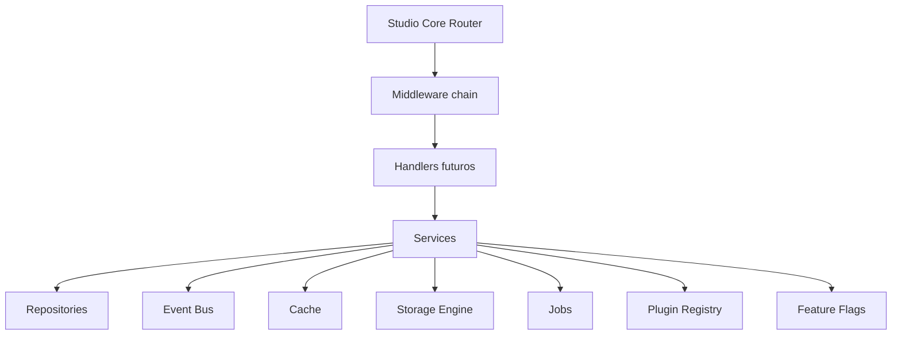

# TS Studio Milestone 2 Report

Data: 2026-07-09
Branch: feature/ts-studio-milestone-0-foundation-parity
Status: implementada localmente e validada

## Objetivo

Criar a infraestrutura Core API do TS Studio para servir de base a todos os modulos futuros do CMS administrativo.

## O que foi implementado

- estrutura `src/studio/core`;
- router da Core API;
- mapa de endpoints administrativos planejados;
- contratos de resposta padronizados;
- erro padronizado `StudioApiError`;
- middlewares de seguranca;
- event bus em memoria;
- cache em memoria;
- repositórios em memoria;
- services por dominio;
- storage engine abstrata;
- job queue abstrata;
- registry de plugins;
- registry de feature flags;
- config service;
- auditor `npm run audit:core`;
- teste estrutural compilavel da Core API.

## Arquitetura final

## Decisoes tecnicas

1. A Core API foi implementada como biblioteca TypeScript isolada.
2. Nenhuma rota foi montada no aplicativo publico.
3. Endpoints ainda nao implementados retornam `501` controlado.
4. Services nao acessam Supabase diretamente.
5. Repositories sao interfaces com implementacao em memoria para testes.
6. Storage usa adapter para Supabase, S3, R2, Bunny ou MinIO.
7. Plugins sao apenas registry, sem execucao de codigo externo.
8. Feature flags nao substituem RBAC.

## Riscos conhecidos

| Risco | Status | Mitigacao |
| --- | --- | --- |
| Runtime oficial de API ainda nao ligado | esperado | conectar em milestone futura com Vercel Functions ou runtime aprovado |
| Repositories em memoria nao persistem | esperado | substituir por adapters Supabase server-side |
| Rate limit em memoria nao escala horizontalmente | esperado | trocar por Redis/Upstash quando API real existir |
| Plugins podem aumentar superficie futura | controlado | registry sem execucao externa |

## Impactos

| Area | Impacto |
| --- | --- |
| Site publico | nenhum |
| Rotas publicas | nenhum |
| Supabase remoto | nenhum |
| Edge Functions remotas | nenhum |
| Migrations remotas | nenhuma |
| Performance publica | nenhum impacto esperado |
| SEO | nenhum impacto |
| UX publica | nenhum impacto |

## Auditorias adicionadas

- `npm run audit:core`
- `npm run audit` agora inclui `audit:core`
- `audit:ts-studio` reconhece os novos documentos e diretorio Core

## Criterios de aceite

- Core API isolada em `src/studio/core`.
- Nenhum acesso direto a Supabase dentro do Core.
- Middlewares obrigatorios existentes.
- Services e repositories existentes.
- Endpoints administrativos registrados.
- Documentacao criada.
- Validacoes finais executadas antes de commit.

## Validacoes executadas

| Comando | Resultado |
| --- | --- |
| `npm run lint` | aprovado com 15 warnings preexistentes em arquivos publicos/UI |
| `npm run typecheck` | aprovado |
| `npm run build` | aprovado com aviso preexistente de bundle grande e Browserslist desatualizado |
| `npm run audit` | aprovado |
| `npm run audit:core` | aprovado |
| `npm run audit:auth` | aprovado |
| `npm run audit:ts-studio` | aprovado |
| `npm run audit:edge-functions` | aprovado via `deno check` |
| `git diff --check` | aprovado, apenas avisos de normalizacao CRLF do Git |

## Proximos passos

1. Fazer commit da Milestone 2.
2. Publicar a branch.
3. Aguardar autorizacao antes da Milestone 3.
