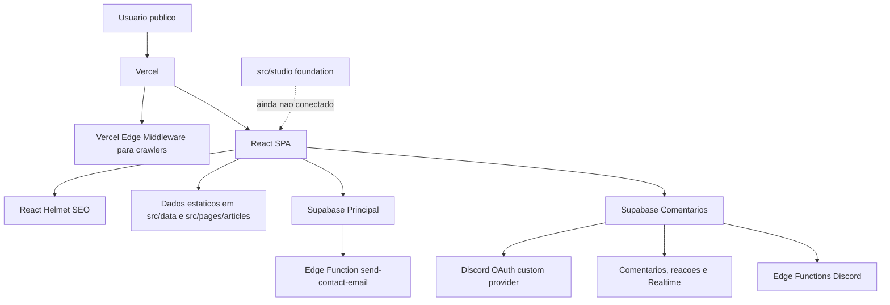
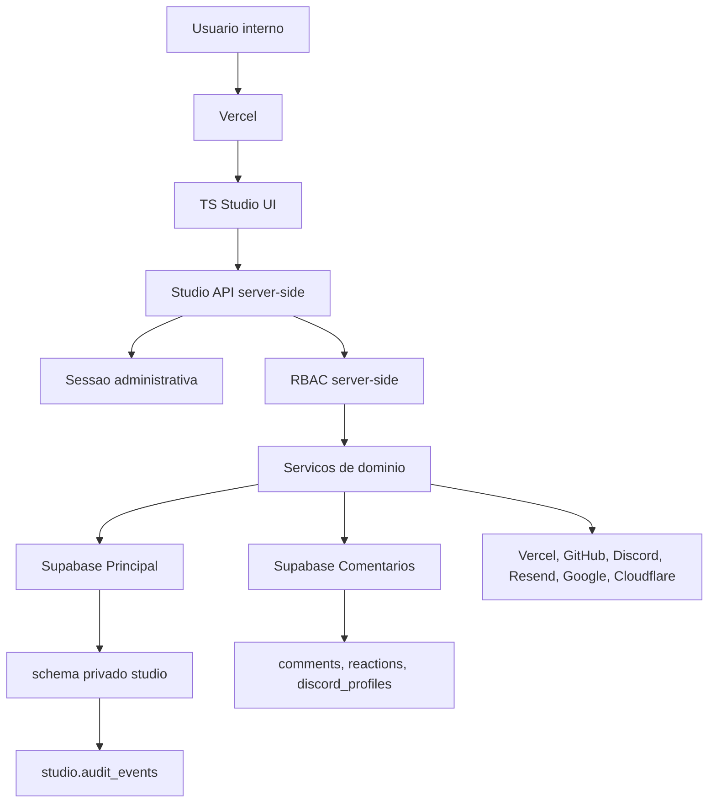
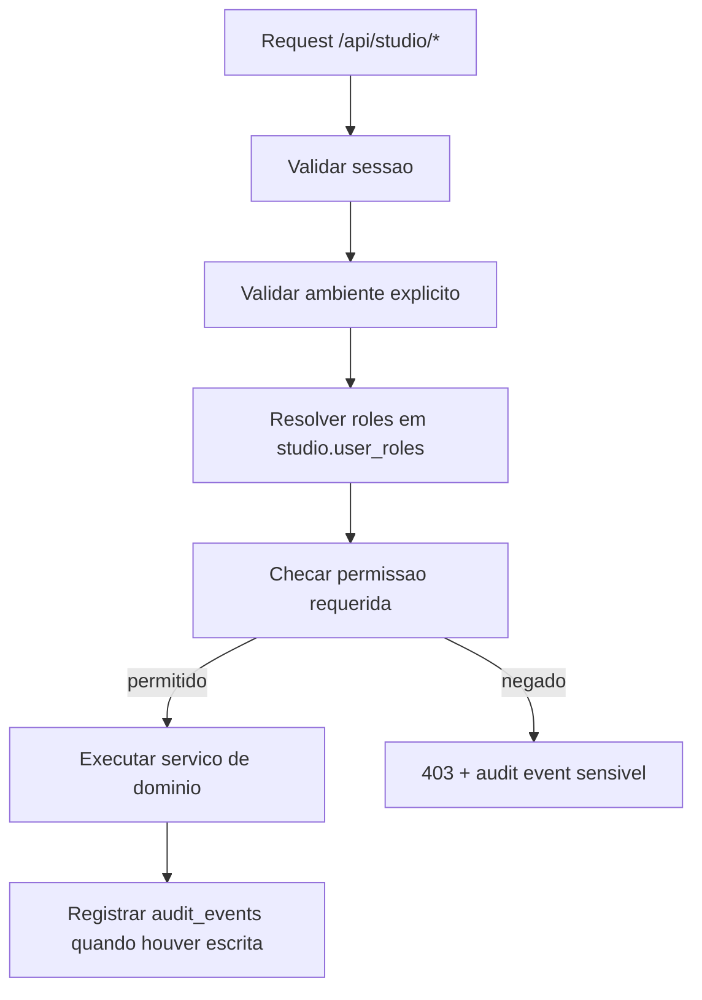
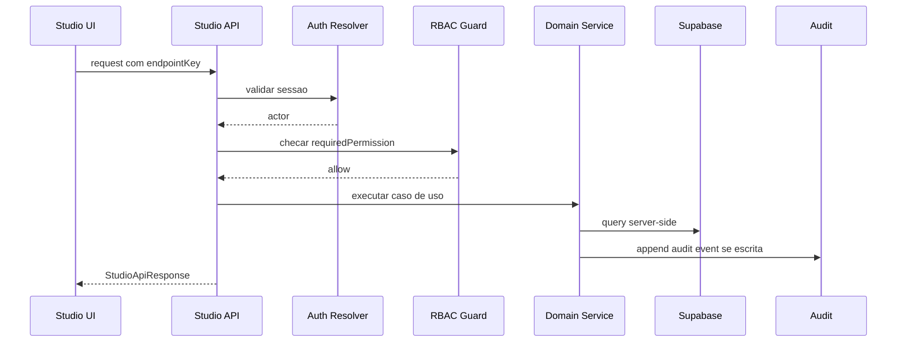
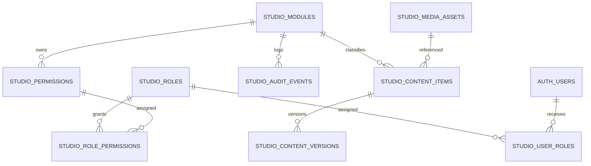
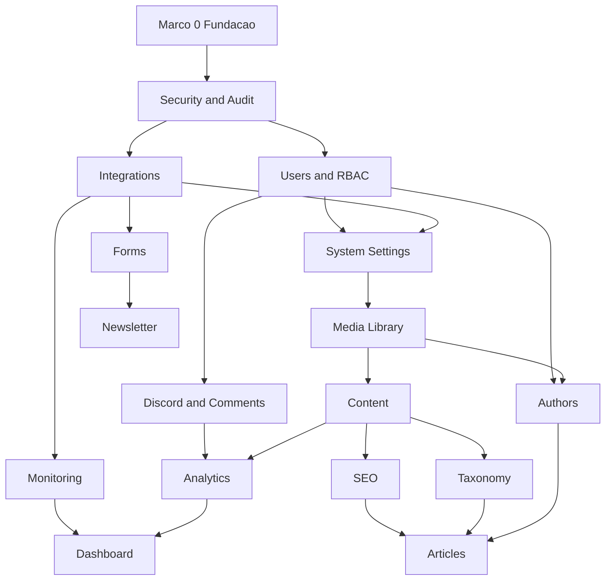

# TS Studio Official Architecture Specification

Data: 2026-07-09
Status: especificacao oficial antes de implementar funcionalidades
Escopo: arquitetura, contratos, padronizacao e engenharia reversa do projeto atual

Este documento e a fonte unica de verdade para a evolucao do TS Studio. Ele descreve o estado real do projeto, a arquitetura alvo do CMS, os contratos que devem ser respeitados, a ordem de implementacao e os limites que nao podem ser ultrapassados sem uma revisao arquitetural.

Este documento nao ativa funcionalidades. Nenhuma rota publica do Studio foi ligada ao `App.tsx`. Nenhuma migration remota foi aplicada. Nenhuma Edge Function foi publicada. Nenhum deploy foi realizado.

## Principios oficiais

1. O site publico continua funcionando sem depender do TS Studio.
2. O TS Studio deve ser implementado por modulos independentes e testaveis.
3. O Supabase Principal e o Supabase Comentarios permanecem separados.
4. O schema `studio` pertence ao Supabase Principal e deve continuar privado.
5. O browser nunca acessa `studio` diretamente.
6. Toda API administrativa deve rodar server-side.
7. Toda API administrativa deve validar sessao, ambiente e RBAC antes de consultar dados.
8. Toda escrita administrativa deve registrar auditoria.
9. Nenhum ambiente pode usar Production como fallback.
10. Nenhum segredo pode ser exposto em variavel `VITE_*`.
11. Dashboard, Analytics e Monitoring sao consumidores de dados, nao donos das regras de negocio.
12. Plugins futuros nao herdam permissao automaticamente.

## Estado atual do projeto

### Stack

| Area | Implementacao atual |
| --- | --- |
| Aplicacao | React 18, Vite, TypeScript |
| UI | Tailwind CSS, Radix UI, shadcn-style components, lucide-react |
| Rotas | `react-router-dom` com `BrowserRouter` |
| SEO client-side | `react-helmet-async` via `src/components/SEO.tsx` |
| SEO crawler-side | `middleware.ts` no Vercel Edge Middleware |
| Estado remoto | `@tanstack/react-query` instalado, usado como provider global |
| Tema e idioma | `ThemeContext` em `src/contexts/ThemeContext.tsx` |
| Supabase Principal | `src/integrations/supabase` |
| Supabase Comentarios | `src/integrations/supabase-comments` |
| Edge Functions Principal | `send-contact-email` |
| Edge Functions Comentarios | `discord-post-login`, `discord-refresh-profile`, `discord-userinfo` |
| CMS futuro | `src/studio`, ainda isolado da aplicacao publica |
| Hosting | Vercel, com redirects, headers e rewrite SPA em `vercel.json` |

### Estrutura fonte

```text
src/
  App.tsx
  main.tsx
  assets/
  components/
  contexts/
  data/
  hooks/
  integrations/
  lib/
  pages/
  studio/
  utils/
supabase/
  projects/
    main/
    comments/
  legacy-mixed/
public/
scripts/
docs/
```

### Camadas atuais



## Arquitetura alvo do TS Studio



O TS Studio deve nascer como uma camada administrativa server-side. Componentes React podem esconder botoes por permissao, mas a autorizacao verdadeira sempre pertence ao backend.

## Ambientes

| Ambiente | Uso | Regra |
| --- | --- | --- |
| Development | desenvolvimento local | deve apontar para projetos explicitamente definidos |
| Preview | branches e revisao | nunca pode cair em Production |
| Staging | validacao antes de producao | deve usar Supabase Principal e Comentarios proprios |
| Production | site publico real | somente apos revisao, migration validada e deploy aprovado |

Variaveis obrigatorias do frontend:

| Variavel | Dono | Exposta ao browser | Observacao |
| --- | --- | --- | --- |
| `VITE_SUPABASE_URL` | Supabase Principal | sim | deve conter URL do projeto correto |
| `VITE_SUPABASE_PUBLISHABLE_KEY` | Supabase Principal | sim | chave publica/publishable |
| `VITE_SUPABASE_PROJECT_ID` | Supabase Principal | sim | deve bater com o ref da URL |
| `VITE_COMMENTS_SUPABASE_URL` | Supabase Comentarios | sim | deve conter URL do projeto correto |
| `VITE_COMMENTS_SUPABASE_PUBLISHABLE_KEY` | Supabase Comentarios | sim | chave publica/publishable |
| `VITE_COMMENTS_SUPABASE_PROJECT_ID` | Supabase Comentarios | sim | deve bater com o ref da URL |

Variaveis futuras do Studio:

| Variavel | Dono | Exposta ao browser | Obrigatoria quando ativar Studio |
| --- | --- | --- | --- |
| `VITE_STUDIO_ENABLED` | Vercel | sim | sim, para ativacao controlada |
| `VITE_STUDIO_ENVIRONMENT` | Vercel | sim | sim, sem fallback |
| `STUDIO_SESSION_SECRET` | API Studio | nao | sim |
| `STUDIO_ALLOWED_ORIGINS` | API Studio | nao | sim |
| `STUDIO_SERVICE_ROLE_KEY` | API Studio | nao | sim, se APIs usarem service role |

## Mapa de rotas publicas

### PT-BR

| Rota | Componente |
| --- | --- |
| `/` | `Index` |
| `/sobre` | `About` |
| `/projetos` | `Projects` |
| `/projetos/:id` | `ProjectDetail` |
| `/servicos` | `Services` |
| `/servicos/:serviceId` | `ServiceDetail` |
| `/carreira` | `Career` |
| `/contato` | `Contact` |
| `/como-trabalho` | `HowIWork` |
| `/decisoes-tecnicas` | `TechDecisions` |
| `/acessibilidade` | `Accessibility` |
| `/livro` | `Book` |
| `/principios` | `Principles` |
| `/checklists` | `Checklists` |
| `/checklists/:checklistId` | `ChecklistDetail` |
| `/artigos` | `Articles` |
| `/artigos/tag/:tag` | `TagPage` |
| `/trilhas/:trailId` | `TrailPage` |
| `/artigos/:slug` | `MarketTrailArticle` |
| `/politica-de-privacidade` | `PrivacyPolicy` |
| `/faq` | `FAQ` |
| `/feedbacks` | `Feedbacks` |
| `/politicas` | `Policies` |
| `/politicas/:sectionId` | `PolicyDetail` |

### EN-US

| Rota | Componente |
| --- | --- |
| `/en-us` | `Index` |
| `/en-us/about` | `About` |
| `/en-us/projects` | `Projects` |
| `/en-us/projects/:id` | `ProjectDetail` |
| `/en-us/services` | `Services` |
| `/en-us/services/:serviceId` | `ServiceDetail` |
| `/en-us/career` | `Career` |
| `/en-us/contact` | `Contact` |
| `/en-us/how-i-work` | `HowIWork` |
| `/en-us/tech-decisions` | `TechDecisions` |
| `/en-us/accessibility` | `Accessibility` |
| `/en-us/book` | `Book` |
| `/en-us/principles` | `Principles` |
| `/en-us/checklists` | `Checklists` |
| `/en-us/checklists/:checklistId` | `ChecklistDetail` |
| `/en-us/articles` | `Articles` |
| `/en-us/articles/tag/:tag` | `TagPage` |
| `/en-us/trails/:trailId` | `TrailPage` |
| `/en-us/articles/:slug` | `MarketTrailArticle` |
| `/en-us/privacy-policy` | `PrivacyPolicy` |
| `/en-us/faq` | `FAQ` |
| `/en-us/feedbacks` | `Feedbacks` |
| `/en-us/policies` | `Policies` |
| `/en-us/policies/:sectionId` | `PolicyDetail` |

### Aliases ingleses sem prefixo

| Rota | Componente |
| --- | --- |
| `/about` | `About` |
| `/projects` | `Projects` |
| `/projects/:id` | `ProjectDetail` |
| `/services` | `Services` |
| `/services/:serviceId` | `ServiceDetail` |
| `/career` | `Career` |
| `/contact` | `Contact` |

### Rotas Studio previstas

| Rota | Modulo | Status |
| --- | --- | --- |
| `/studio` | Dashboard | foundation |
| `/studio/content` | Content | foundation |
| `/studio/articles` | Articles | planned |
| `/studio/taxonomy` | Categories and Tags | planned |
| `/studio/authors` | Authors | planned |
| `/studio/seo` | SEO and Metadata | foundation |
| `/studio/media` | Media Library | foundation |
| `/studio/users` | Users and Profiles | foundation |
| `/studio/discord` | Discord and Comments | foundation |
| `/studio/forms` | Forms and Contact | foundation |
| `/studio/newsletter` | Newsletter | planned |
| `/studio/analytics` | Analytics | foundation |
| `/studio/monitoring` | Monitoring | foundation |
| `/studio/security` | Security and Audit | foundation |
| `/studio/integrations` | Integrations | foundation |
| `/studio/system` | System Settings | foundation |

Essas rotas existem somente no registry de `src/studio/routes/registry.ts`. Elas ainda nao estao conectadas ao roteador publico.

## Mapa de APIs e endpoints atuais

### Edge Functions

| Projeto | Function | Metodo | JWT | Objetivo |
| --- | --- | --- | --- | --- |
| Principal | `send-contact-email` | GET | true | gerar CAPTCHA assinado |
| Principal | `send-contact-email` | POST | true | validar formulario, CAPTCHA, rate limit e enviar email via Resend |
| Comentarios | `discord-userinfo` | GET | false | endpoint userinfo do provider OAuth custom |
| Comentarios | `discord-post-login` | POST | true | sincronizar perfil, entrar no servidor Discord, aplicar cargo e limpar identidade legado |
| Comentarios | `discord-refresh-profile` | POST | true | atualizar perfil Discord por bot token |

### Contratos Studio atuais

| Endpoint | Metodo | Permissao | Auditoria |
| --- | --- | --- | --- |
| `/api/studio/dashboard/summary` | GET | `dashboard.read` | nao |
| `/api/studio/content` | GET | `content.read` | nao |
| `/api/studio/content` | POST | `content.write` | `content.create` |
| `/api/studio/content/:id/publish` | POST | `content.publish` | `content.publish` |
| `/api/studio/media` | POST | `media.write` | `media.register` |
| `/api/studio/discord/comments/:id/moderate` | POST | `discord.moderate` | `discord.comment.moderate` |
| `/api/studio/security/audit-events` | GET | `security.read` | nao |

Esses endpoints sao contratos em `src/studio/api/contracts.ts`. Ainda nao existem como rotas executaveis.

### Contrato padrao de API Studio

Entrada:

```ts
interface StudioApiRequest<TBody = Record<string, unknown>> {
  endpointKey: string;
  actorId: string;
  requestId: string;
  body?: TBody;
}
```

Saida:

```ts
interface StudioApiResponse<TData = unknown> {
  ok: boolean;
  data?: TData;
  error?: {
    code: string;
    message: string;
  };
}
```

Erros oficiais:

- `studio.endpoint_unknown`
- `studio.auth_required`
- `studio.permission_denied`
- `studio.validation_failed`
- `studio.conflict`
- `studio.provider_unavailable`
- `studio.audit_failed`

## Mapa do banco

### Supabase Principal

Project ref atual em `config.toml`: `xbjkbziaxwsjzsmxilap`.

Tabelas publicas:

| Tabela | Finalidade atual | Observacao para TS Studio |
| --- | --- | --- |
| `public.profiles` | perfis do projeto principal legado | nao e base do Studio sem revisao |
| `public.blogs` | blog legado no projeto principal | conteudo atual do site esta em arquivos, nao nessa tabela |
| `public.blog_comments` | comentarios legado no projeto principal | sistema ativo de comentarios usa projeto Comentarios |
| `public.newsletter_subscribers` | assinantes newsletter | deve ser administrado pelo modulo Newsletter |
| `public.contact_rate_limits` | rate limit hash por escopo | usado por `send-contact-email` |

Schema privado `studio`:

| Tabela | Finalidade |
| --- | --- |
| `studio.modules` | catalogo de modulos |
| `studio.module_dependencies` | dependencias entre modulos |
| `studio.roles` | papeis administrativos |
| `studio.permissions` | permissoes atomicas |
| `studio.role_permissions` | matriz papel/permissao |
| `studio.user_roles` | atribuicoes administrativas por usuario |
| `studio.content_items` | conteudo generico do CMS |
| `studio.content_versions` | versionamento de conteudo |
| `studio.media_assets` | metadados de Storage |
| `studio.settings` | configuracoes globais |
| `studio.integration_connections` | inventario de provedores externos |
| `studio.jobs` | tarefas e filas futuras |
| `studio.audit_events` | auditoria administrativa |
| `studio.notifications` | notificacoes internas futuras |
| `studio.feature_flags` | feature flags |

Controles do schema `studio`:

- `REVOKE ALL` de `PUBLIC`, `anon` e `authenticated`;
- `GRANT USAGE` e privilegios de tabela apenas para `service_role`;
- RLS habilitado em todas as tabelas;
- RLS forcado em todas as tabelas;
- nenhuma policy para browser;
- acesso futuro somente por API server-side.

Storage:

| Bucket | Projeto | Publico | Uso atual |
| --- | --- | --- | --- |
| `blog-images` | Principal | sim | imagens de blog e assets gerenciaveis futuramente |

RPC:

| Funcao | Projeto | Uso |
| --- | --- | --- |
| `public.check_contact_rate_limit` | Principal | rate limit do contato |
| `public.handle_new_user` | Principal | trigger legado de perfil |
| `public.update_updated_at_column` | Principal | updated_at legado |

### Supabase Comentarios

Project ref atual em `config.toml`: `rfzjtmleojkojopftkfo`.

Tabelas:

| Tabela | Finalidade |
| --- | --- |
| `public.user_roles` | papeis do sistema de comentarios |
| `public.discord_profiles` | perfil minimo Discord |
| `public.comments` | comentarios por artigo |
| `public.comment_reactions` | reacoes em comentarios |
| `public.discord_identity_migrations` | migracao de identidade Discord legado |
| `public.contact_rate_limits` | rate limit para fluxos Discord |

RPC e funcoes:

| Funcao | Uso |
| --- | --- |
| `public.has_role` | checagem de papel no projeto Comentarios |
| `public.sanitize_comment` | sanitizacao de comentario |
| `public.enforce_comment_depth` | limite de profundidade |
| `public.enforce_comment_rate_limit` | controle de abuso |
| `public.set_updated_at` | updated_at generico |
| `public.set_comment_updated_at` | updated_at de comentarios |
| `public.handle_discord_user` | sincronizacao de usuario Auth para perfil |
| `public.stats_readers_total` | estatistica autenticada |
| `public.stats_comments_total` | estatistica autenticada |
| `public.stats_comments_by_article` | estatistica autenticada |
| `public.stats_most_commented_article` | estatistica autenticada |
| `public.set_discord_profile_verification` | badge verificado |
| `public.check_contact_rate_limit` | rate limit de Edge Functions Discord |

Realtime:

- `public.comments` publicado em `supabase_realtime`;
- `public.comment_reactions` publicado em `supabase_realtime`;
- policy em `realtime.messages` permite usuarios autenticados lerem topicos `comments:%`.

### Supabase legado

`supabase/legacy-mixed` contem migrations historicas misturadas. Ele nao deve receber novas alteracoes e nao deve ser usado como fonte operacional para deploy. Qualquer informacao relevante deve ser migrada para `supabase/projects/main` ou `supabase/projects/comments` com migration propria.

## Mapa de RBAC

### Roles existentes no codigo

| Role | Rank | Uso |
| --- | ---: | --- |
| `owner` | 100 | controle total |
| `admin` | 80 | administracao operacional |
| `editor` | 60 | conteudo, SEO e midia |
| `moderator` | 50 | comentarios e comunidade |
| `analyst` | 30 | analytics, monitoramento e leitura |
| `viewer` | 10 | leitura basica |

### Matriz oficial

| Permissao | Owner | Admin | Editor | Autor futuro | Moderator | Analyst | Suporte futuro | Viewer | Visitante |
| --- | --- | --- | --- | --- | --- | --- | --- | --- | --- |
| `dashboard.read` | sim | sim | sim | sim | sim | sim | sim | sim | nao |
| `content.read` | sim | sim | sim | sim | sim | sim | sim | sim | nao |
| `content.write` | sim | sim | sim | proprio conteudo | nao | nao | nao | nao | nao |
| `content.publish` | sim | sim | sim | nao | nao | nao | nao | nao | nao |
| `articles.read` | sim | sim | sim | sim | sim | sim | sim | sim | nao |
| `articles.write` | sim | sim | sim | proprio artigo | nao | nao | nao | nao | nao |
| `articles.publish` | sim | sim | sim | nao | nao | nao | nao | nao | nao |
| `taxonomy.read` | sim | sim | sim | sim | nao | sim | sim | nao | nao |
| `taxonomy.write` | sim | sim | sim | nao | nao | nao | nao | nao | nao |
| `authors.read` | sim | sim | sim | sim | nao | sim | sim | nao | nao |
| `authors.write` | sim | sim | sim | proprio perfil | nao | nao | nao | nao | nao |
| `seo.read` | sim | sim | sim | sim | nao | sim | sim | sim | nao |
| `seo.write` | sim | sim | sim | nao | nao | nao | nao | nao | nao |
| `seo.manage` | sim | sim | nao | nao | nao | nao | nao | nao | nao |
| `media.read` | sim | sim | sim | sim | nao | sim | sim | sim | nao |
| `media.write` | sim | sim | sim | proprio asset | nao | nao | nao | nao | nao |
| `media.manage` | sim | sim | nao | nao | nao | nao | nao | nao | nao |
| `users.read` | sim | sim | nao | nao | nao | nao | sim | nao | nao |
| `users.manage` | sim | nao | nao | nao | nao | nao | nao | nao | nao |
| `users.audit` | sim | nao | nao | nao | nao | nao | nao | nao | nao |
| `discord.read` | sim | sim | nao | nao | sim | sim | sim | nao | nao |
| `discord.moderate` | sim | sim | nao | nao | sim | nao | sim limitado | nao | nao |
| `discord.manage` | sim | nao | nao | nao | nao | nao | nao | nao | nao |
| `forms.read` | sim | sim | nao | nao | nao | sim | sim | nao | nao |
| `forms.manage` | sim | sim | nao | nao | nao | nao | nao | nao | nao |
| `newsletter.read` | sim | sim | nao | nao | nao | sim | sim | nao | nao |
| `newsletter.write` | sim | sim | nao | nao | nao | nao | nao | nao | nao |
| `newsletter.manage` | sim | sim | nao | nao | nao | nao | nao | nao | nao |
| `analytics.read` | sim | sim | sim | sim | nao | sim | sim | sim | nao |
| `monitoring.read` | sim | sim | nao | nao | nao | sim | sim | nao | nao |
| `monitoring.manage` | sim | sim | nao | nao | nao | nao | nao | nao | nao |
| `security.read` | sim | sim | nao | nao | nao | sim | nao | nao | nao |
| `security.manage` | sim | nao | nao | nao | nao | nao | nao | nao | nao |
| `security.audit` | sim | nao | nao | nao | nao | nao | nao | nao | nao |
| `integrations.read` | sim | sim | nao | nao | nao | sim | sim | nao | nao |
| `integrations.manage` | sim | sim | nao | nao | nao | nao | nao | nao | nao |
| `system.read` | sim | sim | nao | nao | nao | sim | sim | nao | nao |
| `system.manage` | sim | nao | nao | nao | nao | nao | nao | nao | nao |

Observacao: `Autor futuro` e `Suporte futuro` ainda nao existem no codigo. Eles so podem ser ativados depois de migration, seed, testes e atualizacao de `StudioRoleKey`.

Fluxo RBAC:



## Catalogo completo do CMS

### Dashboard

| Campo | Especificacao |
| --- | --- |
| Nome | Dashboard |
| Objetivo | oferecer visao operacional do site, comunidade, SEO, formularios, integracoes e seguranca |
| Descricao | modulo agregador, deve ler summaries ja preparados por outros modulos |
| Dependencias | Monitoring, Analytics, Integrations, Security |
| Pre-requisitos | APIs de summaries por modulo, RBAC server-side, audit events persistidos |
| Responsabilidades | cards, alertas, pendencias, atividade recente, status de provedores |
| Limites | nao altera regras de negocio dos modulos de origem |
| Fluxo | carregar summary, filtrar por permissao, exibir cards, permitir reconhecer alerta |
| Tabelas | `studio.audit_events`, `studio.jobs`, `studio.integration_connections`, summaries futuras |
| Storage | nenhum direto |
| Policies/RLS | acesso via API, schema `studio` privado |
| Edge Functions | nenhuma direta |
| APIs | `GET /api/studio/dashboard/summary`, futuras activity e alerts |
| Eventos | `dashboard.viewed`, `dashboard.alert.acknowledged` |
| Logs | request id, tempo de consulta, modulos indisponiveis |
| Auditoria | alert acknowledge e filtros sensiveis |
| Permissoes | `dashboard.read` |
| Papeis | owner, admin, editor, moderator, analyst, viewer |
| Componentes | `StudioDashboardPage`, futuros `DashboardSummaryGrid`, `OperationalHealthCard` |
| Hooks | `useStudioModules`, futuro `useDashboardSummary` |
| Providers | `StudioProvider`, `QueryClientProvider` |
| Stores | session store para sessao, cache/query futuro |
| Rotas | `/studio` |
| Servicos | dashboard summary service futuro |
| Integracoes | Vercel, Supabase, GitHub, Discord, Resend |
| Env vars | nenhuma propria, herda ambiente do Studio |
| Configuracoes | visibilidade de cards por role |
| Riscos | dado de modulo sem permissao, ruido, metricas incompletas |
| Performance | usar summaries cacheaveis e timeouts por provider |
| SEO | nao indexar, rota admin |
| Seguranca | nao exibir detalhes sensiveis para roles sem permissao |
| Conclusao | dashboard respeita permissoes e mostra estados ok, degraded e unavailable |
| Rollback | desativar rota e manter modulos de origem independentes |

### Content

| Campo | Especificacao |
| --- | --- |
| Nome | Content |
| Objetivo | administrar conteudo generico versionado |
| Descricao | base para artigos, paginas, blocos, politicas, checklists e trilhas |
| Dependencias | Media, Security, Users |
| Pre-requisitos | `studio.content_items`, `studio.content_versions`, RBAC de escrita e publish |
| Responsabilidades | rascunho, edicao, revisao, publicacao, arquivo e restauracao |
| Limites | nao deve publicar sem workflow, nao deve escrever em `src/data` diretamente em runtime |
| Fluxo | criar draft, editar, versionar, revisar, publicar, arquivar |
| Tabelas | `studio.content_items`, `studio.content_versions` |
| Storage | referencia assets de `studio.media_assets` |
| Policies/RLS | apenas API server-side |
| Edge Functions | nenhuma obrigatoria |
| APIs | `/api/studio/content`, `/api/studio/content/:id/publish` |
| Eventos | `content.create`, `content.update`, `content.publish`, `content.archive`, `content.restore_version` |
| Logs | alteracoes de slug, status, autor, revisor |
| Auditoria | toda escrita e toda publicacao |
| Permissoes | `content.read`, `content.write`, `content.publish` |
| Papeis | owner, admin, editor, autor futuro limitado |
| Componentes | `ContentList`, `ContentEditorShell`, `ContentVersionTimeline` futuros |
| Hooks | `useContentItems`, `useContentItem`, `useContentVersions` futuros |
| Providers | `StudioProvider`, query provider |
| Stores | cache de drafts futuro, nunca fonte unica |
| Rotas | `/studio/content` |
| Servicos | content service, version service |
| Integracoes | Supabase Principal, SEO, Media |
| Env vars | nenhuma propria |
| Configuracoes | status permitidos, locales, workflow |
| Riscos | vazamento de rascunho, slug duplicado, perda de historico |
| Performance | paginar lista e evitar carregar body completo em listagem |
| SEO | canonical e metadata passam pelo modulo SEO |
| Seguranca | publish separado de write |
| Conclusao | CRUD e workflow testados em staging |
| Rollback | restaurar versao anterior ou arquivar conteudo publicado |

### Articles

| Campo | Especificacao |
| --- | --- |
| Nome | Articles |
| Objetivo | administrar artigos longos e trilhas editoriais |
| Descricao | especializacao do Content para artigos, fontes, secoes, relacionados, tags e SEO |
| Dependencias | Content, SEO, Taxonomy, Authors, Media |
| Pre-requisitos | Content operacional, taxonomia e autores definidos |
| Responsabilidades | editor de artigo, fontes, tempo de leitura, relacionados, publish editorial |
| Limites | nao duplicar modelo fora de `content_items` |
| Fluxo | criar artigo, editar secoes, vincular autor/tags, validar SEO, publicar |
| Tabelas | `studio.content_items`, `studio.content_versions`, futuras `studio.taxonomies`, `studio.authors` |
| Storage | imagens de capa e corpo via Media |
| Policies/RLS | acesso via API |
| Edge Functions | nenhuma obrigatoria |
| APIs | futuras `/api/studio/articles` |
| Eventos | `articles.create`, `articles.update`, `articles.source.updated`, `articles.publish` |
| Logs | slug, fonte, relacao, validaçao SEO |
| Auditoria | escrita, publish, slug change |
| Permissoes | `articles.read`, `articles.write`, `articles.publish` |
| Papeis | owner, admin, editor, autor futuro limitado |
| Componentes | `ArticleEditor`, `ArticleSeoPanel`, `ArticleSourceManager` futuros |
| Hooks | `useArticles`, `useArticleEditor`, `useArticleValidation` futuros |
| Providers | Studio/query |
| Stores | draft local temporario futuro |
| Rotas | `/studio/articles` |
| Servicos | article service usando content service |
| Integracoes | `src/data/articles.ts`, `src/data/market-trail`, sitemap, middleware OG |
| Env vars | nenhuma propria |
| Configuracoes | campos obrigatorios antes de publish |
| Riscos | fonte de verdade duplicada entre arquivos e CMS |
| Performance | evitar carregar artigos grandes no bundle futuramente |
| SEO | obrigatorio antes de publish |
| Seguranca | validar HTML/markdown se editor rico for adotado |
| Conclusao | artigo completo publicado em staging sem quebrar rotas |
| Rollback | restore de versao ou unpublish |

### Categories and Tags

| Campo | Especificacao |
| --- | --- |
| Nome | Categories and Tags |
| Objetivo | governar taxonomia editorial |
| Descricao | categorias, tags, trilhas, aliases e merges |
| Dependencias | Content, SEO |
| Pre-requisitos | estrategia de slug e redirect |
| Responsabilidades | criar, renomear, unir, arquivar, detectar orfas |
| Limites | nao quebrar URL publicada sem redirect |
| Fluxo | criar termo, vincular conteudo, revisar uso, publicar |
| Tabelas | `studio.content_items`; futuras `studio.taxonomies`, `studio.content_taxonomies` |
| Storage | nenhum |
| Policies/RLS | acesso via API |
| Edge Functions | nenhuma |
| APIs | futuras `/api/studio/taxonomy` |
| Eventos | `taxonomy.create`, `taxonomy.update`, `taxonomy.merge`, `taxonomy.archive` |
| Logs | slug antigo, slug novo, quantidade de conteudos afetados |
| Auditoria | merge e renomeacao sempre |
| Permissoes | `taxonomy.read`, `taxonomy.write` |
| Papeis | owner, admin, editor, analyst leitura |
| Componentes | `TaxonomyTree`, `TagEditor`, `TaxonomyMergeDialog` futuros |
| Hooks | `useTaxonomies`, `useTagUsage` futuros |
| Providers | Studio/query |
| Stores | nenhum permanente |
| Rotas | `/studio/taxonomy` |
| Servicos | taxonomy service |
| Integracoes | `/artigos/tag/:tag`, trilhas, sitemap |
| Env vars | nenhuma |
| Configuracoes | politica de slug por locale |
| Riscos | tag sprawl, rota orfa, canonical antigo |
| Performance | contadores agregados por uso |
| SEO | alto impacto em URLs de tags |
| Seguranca | validar entrada textual |
| Conclusao | merge preserva referencias e auditoria |
| Rollback | restaurar snapshot de taxonomy e redirects |

### Authors

| Campo | Especificacao |
| --- | --- |
| Nome | Authors |
| Objetivo | administrar autores e autoridade editorial |
| Descricao | perfis, bio, foto, links e relacao com conteudos |
| Dependencias | Users, Media, SEO |
| Pre-requisitos | decidir autores internos versus autores editoriais independentes |
| Responsabilidades | byline, bio, avatar, social links, historico |
| Limites | nao apagar autor usado por conteudo publicado |
| Fluxo | criar perfil, revisar, vincular artigo, arquivar |
| Tabelas | futura `studio.authors`, `studio.user_roles`, `studio.media_assets`, `studio.content_items` |
| Storage | avatar via Media |
| Policies/RLS | API server-side |
| Edge Functions | nenhuma |
| APIs | futuras `/api/studio/authors` |
| Eventos | `authors.create`, `authors.update`, `authors.avatar.changed` |
| Logs | alteracao de bio, avatar e links |
| Auditoria | alteracoes publicas de autoria |
| Permissoes | `authors.read`, `authors.write` |
| Papeis | owner, admin, editor, autor futuro proprio perfil |
| Componentes | `AuthorList`, `AuthorProfileEditor` futuros |
| Hooks | `useAuthors`, `useAuthorProfile` futuros |
| Providers | Studio/query |
| Stores | nenhum permanente |
| Rotas | `/studio/authors` |
| Servicos | author service |
| Integracoes | Schema.org Article, Media |
| Env vars | nenhuma |
| Configuracoes | campos obrigatorios para author schema |
| Riscos | autoria incorreta, link quebrado, imagem sem alt |
| Performance | lista paginada |
| SEO | impacta Article schema |
| Seguranca | evitar links maliciosos |
| Conclusao | autor vinculado a artigo sem inconsistencia |
| Rollback | restaurar versao anterior do perfil |

### SEO and Metadata

| Campo | Especificacao |
| --- | --- |
| Nome | SEO and Metadata |
| Objetivo | governar metadados e crawlers |
| Descricao | title, description, canonical, Open Graph, Twitter Card, JSON-LD, sitemap, robots |
| Dependencias | Content, Media, System |
| Pre-requisitos | dominio por ambiente e estrategia de sitemap |
| Responsabilidades | validar metadata, preview social, schema, sitemap |
| Limites | nao publicar divergencia entre client SEO e middleware |
| Fluxo | editar metadata, validar, preview, publicar com conteudo |
| Tabelas | `studio.content_items.seo`, `og`, `schema_json`, `studio.settings` |
| Storage | imagens OG via Media |
| Policies/RLS | API server-side |
| Edge Functions | Vercel middleware atual para crawlers |
| APIs | futuras `/api/studio/seo` |
| Eventos | `seo.metadata.updated`, `seo.canonical.changed`, `seo.schema.updated` |
| Logs | validacoes e divergencias |
| Auditoria | alteracao de canonical, robots, sitemap |
| Permissoes | `seo.read`, `seo.write`, `seo.manage` |
| Papeis | owner, admin, editor, analyst leitura |
| Componentes | `SeoPreview`, `OpenGraphPreview`, `SchemaJsonEditor` futuros |
| Hooks | `useSeoRoutes`, `useSeoValidation` futuros |
| Providers | `HelmetProvider`, Studio/query |
| Stores | nenhum permanente |
| Rotas | `/studio/seo` |
| Servicos | SEO validation service |
| Integracoes | `src/components/SEO.tsx`, `middleware.ts`, `public/sitemap.xml`, `public/robots.txt` |
| Env vars | dominio publico futuro por ambiente |
| Configuracoes | base URL, locales, Twitter handles |
| Riscos | canonical duplicado, OG quebrado, sitemap obsoleto |
| Performance | validacoes sob demanda |
| SEO | modulo critico |
| Seguranca | escapar HTML e validar JSON-LD |
| Conclusao | metadados iguais para usuarios e crawlers |
| Rollback | restaurar snapshot de metadata |

### Media Library

| Campo | Especificacao |
| --- | --- |
| Nome | Media Library |
| Objetivo | administrar assets e uploads |
| Descricao | imagens, PDFs, videos, alt text, uso e archive |
| Dependencias | Security, System |
| Pre-requisitos | bucket e limites revisados |
| Responsabilidades | upload intent, registro, metadata, alt text, archive |
| Limites | nao deletar fisicamente asset usado por conteudo publicado |
| Fluxo | validar upload, gravar Storage, registrar metadata, vincular conteudo |
| Tabelas | `studio.media_assets`, `storage.objects` |
| Storage | `blog-images` inicialmente |
| Policies/RLS | Storage policies e API server-side |
| Edge Functions | nenhuma obrigatoria |
| APIs | `POST /api/studio/media`, futuras upload-intent e archive |
| Eventos | `media.asset.registered`, `media.alt_text.updated`, `media.asset.archived` |
| Logs | MIME, tamanho, bucket, path, actor |
| Auditoria | toda mudanca de metadata e archive |
| Permissoes | `media.read`, `media.write`, `media.manage` |
| Papeis | owner, admin, editor |
| Componentes | `MediaLibraryGrid`, `MediaUploadDialog` futuros |
| Hooks | `useMediaAssets`, `useMediaUpload` futuros |
| Providers | Studio/query |
| Stores | fila local temporaria de upload |
| Rotas | `/studio/media` |
| Servicos | media service, storage service |
| Integracoes | Supabase Storage |
| Env vars | nenhuma propria |
| Configuracoes | MIME allowlist, tamanho maximo |
| Riscos | MIME falso, arquivo grande, public object leakage |
| Performance | thumbnails, lazy loading, paginacao |
| SEO | alt text e OG image |
| Seguranca | validar MIME real, extensao, tamanho e path |
| Conclusao | asset registrado e auditado |
| Rollback | arquivar asset e restaurar metadata anterior |

### Users and Profiles

| Campo | Especificacao |
| --- | --- |
| Nome | Users and Profiles |
| Objetivo | administrar acesso interno |
| Descricao | usuarios, roles, expiracao, revisao de acesso |
| Dependencias | Security |
| Pre-requisitos | Auth admin definido |
| Responsabilidades | role assignment, access review, lifecycle |
| Limites | nao remover ultimo owner |
| Fluxo | listar usuario, atribuir role, expirar, auditar |
| Tabelas | `auth.users`, `studio.roles`, `studio.permissions`, `studio.user_roles` |
| Storage | nenhum |
| Policies/RLS | schema privado, API server-side |
| Edge Functions | nenhuma |
| APIs | futuras `/api/studio/users`, `/api/studio/rbac` |
| Eventos | `users.role.assigned`, `users.role.removed`, `users.access_review.completed` |
| Logs | actor, target, role, reason |
| Auditoria | toda mudanca de acesso |
| Permissoes | `users.read`, `users.manage`, `users.audit` |
| Papeis | owner para manage, admin leitura futura |
| Componentes | `UserAccessTable`, `RoleMatrix` futuros |
| Hooks | `useStudioUsers`, `useRoleMatrix` futuros |
| Providers | Studio/query |
| Stores | session store |
| Rotas | `/studio/users` |
| Servicos | user service, rbac service |
| Integracoes | Supabase Auth |
| Env vars | secrets da API Studio |
| Configuracoes | expiracao, revisao periodica |
| Riscos | escalada de privilegio, acesso stale |
| Performance | paginacao e filtros |
| SEO | nao indexar |
| Seguranca | modulo critico |
| Conclusao | RBAC testado server-side |
| Rollback | remover role atribuida e registrar evento |

### Discord and Comments

| Campo | Especificacao |
| --- | --- |
| Nome | Discord and Comments |
| Objetivo | administrar comunidade e comentarios |
| Descricao | comentarios, reacoes, perfis Discord, moderacao e Realtime |
| Dependencias | Users, Security, Integrations, Monitoring |
| Pre-requisitos | Supabase Comentarios e OAuth Discord validados |
| Responsabilidades | fila de moderacao, perfis, status OAuth, reacoes |
| Limites | dados de comentarios ficam no projeto Comentarios |
| Fluxo | listar comentarios, moderar, auditar no Principal, atualizar status |
| Tabelas | `comments`, `comment_reactions`, `discord_profiles`, `user_roles` no Supabase Comentarios |
| Storage | nenhum direto |
| Policies/RLS | policies do projeto Comentarios |
| Edge Functions | `discord-post-login`, `discord-refresh-profile`, `discord-userinfo` |
| APIs | `/api/studio/discord/comments/:id/moderate` futuro |
| Eventos | `discord.comment.hidden`, `discord.comment.restored`, `discord.profile.synced` |
| Logs | OAuth failure, moderation action, profile refresh |
| Auditoria | toda moderacao |
| Permissoes | `discord.read`, `discord.moderate`, `discord.manage` |
| Papeis | owner, admin, moderator, support futuro limitado |
| Componentes | `CommentModerationQueue`, `DiscordProfileCard` futuros |
| Hooks | `useModerationQueue`, `useDiscordProfiles` futuros |
| Providers | Studio/query |
| Stores | nenhum permanente |
| Rotas | `/studio/discord` |
| Servicos | comments admin service |
| Integracoes | Discord OAuth, Discord Bot API, Supabase Comentarios, Realtime |
| Env vars | `DISCORD_BOT_TOKEN`, `DISCORD_GUILD_ID`, `DISCORD_READER_ROLE_ID`, salts, origins |
| Configuracoes | callbacks, allowed origins, channels |
| Riscos | token exposto, moderacao no projeto errado, callback drift |
| Performance | paginar comentarios, debounce em Realtime |
| SEO | comentarios podem afetar percepcao publica, nao indexar painel |
| Seguranca | nao expor provider token |
| Conclusao | moderacao altera projeto correto e audita no Principal |
| Rollback | restaurar status anterior do comentario |

### Forms and Contact

| Campo | Especificacao |
| --- | --- |
| Nome | Forms and Contact |
| Objetivo | administrar formulario de contato |
| Descricao | CAPTCHA, rate limit, roteamento, Resend, logs e retencao |
| Dependencias | Security, Integrations |
| Pre-requisitos | Edge Function e secrets configurados |
| Responsabilidades | configuracao de campos, envio de teste, status de email |
| Limites | nao persistir PII sem decisao explicita |
| Fluxo | GET captcha, POST mensagem, validar, rate limit, enviar email |
| Tabelas | `public.contact_rate_limits`, futura `studio.form_submissions` |
| Storage | nenhum |
| Policies/RLS | rate limit service_role only |
| Edge Functions | `send-contact-email` |
| APIs | futuras `/api/studio/forms` |
| Eventos | `forms.settings.updated`, `forms.test_email.sent`, `forms.rate_limit.viewed` |
| Logs | erro de captcha, rate limit, email sent, sem PII bruta |
| Auditoria | mudancas de config e visualizacao sensivel |
| Permissoes | `forms.read`, `forms.manage` |
| Papeis | owner, admin, analyst leitura |
| Componentes | `FormHealthPanel`, `RateLimitTable` futuros |
| Hooks | `useFormSummary`, `useRateLimits` futuros |
| Providers | Studio/query |
| Stores | nenhum |
| Rotas | `/studio/forms` |
| Servicos | form config service |
| Integracoes | Resend, Supabase Principal |
| Env vars | `RESEND_API_KEY`, `CONTACT_CAPTCHA_SECRET`, `CONTACT_RATE_LIMIT_SALT`, `ALLOWED_ORIGINS` |
| Configuracoes | assunto, campos, retencao, limite |
| Riscos | PII em logs, spam, secret ausente |
| Performance | baixa criticidade, chamadas sob demanda |
| SEO | nenhum impacto direto |
| Seguranca | CAPTCHA assinado e rate limit |
| Conclusao | fluxo testado em staging |
| Rollback | restaurar configuracao anterior ou desabilitar envio |

### Newsletter

| Campo | Especificacao |
| --- | --- |
| Nome | Newsletter |
| Objetivo | administrar assinantes e consentimento |
| Descricao | inscritos, segmentos, unsubscribe, campanhas futuras |
| Dependencias | Forms, Integrations, Security |
| Pre-requisitos | politica LGPD e Resend validado |
| Responsabilidades | consentimento, segmentacao, exportacao controlada |
| Limites | nao enviar campanha sem modulo proprio aprovado |
| Fluxo | listar assinante, validar consentimento, segmentar, descadastrar |
| Tabelas | `public.newsletter_subscribers`, futuras consent events e segments |
| Storage | nenhum |
| Policies/RLS | service role para gestao |
| Edge Functions | nenhuma atual |
| APIs | futuras `/api/studio/newsletter` |
| Eventos | `newsletter.subscriber.updated`, `newsletter.unsubscribed`, `newsletter.export.requested` |
| Logs | sem email em log bruto |
| Auditoria | exportacao e mudanca de consentimento |
| Permissoes | `newsletter.read`, `newsletter.write`, `newsletter.manage` |
| Papeis | owner, admin, analyst leitura limitada |
| Componentes | `SubscriberTable`, `ConsentTimeline` futuros |
| Hooks | `useSubscribers`, `useNewsletterSegments` futuros |
| Providers | Studio/query |
| Stores | nenhum |
| Rotas | `/studio/newsletter` |
| Servicos | newsletter service |
| Integracoes | Resend |
| Env vars | Resend se houver campanhas |
| Configuracoes | double opt-in, retencao, exportacao |
| Riscos | vazamento de emails, consentimento ambiguo |
| Performance | paginacao e busca por hash/indice |
| SEO | nenhum |
| Seguranca | minimizar PII |
| Conclusao | consentimento rastreavel |
| Rollback | restaurar consent event anterior quando aplicavel |

### Analytics

| Campo | Especificacao |
| --- | --- |
| Nome | Analytics |
| Objetivo | medir desempenho editorial, comunidade e conversao |
| Descricao | metricas agregadas, sem PII desnecessaria |
| Dependencias | Content, Discord, Forms, Monitoring |
| Pre-requisitos | metricas definidas e fontes estaveis |
| Responsabilidades | dashboards analiticos, exportacao controlada |
| Limites | nao substituir auditoria operacional |
| Fluxo | consultar agregados, filtrar janela, exportar com auditoria |
| Tabelas | `studio.audit_events`, `content_items`, comentarios, newsletter |
| Storage | exportacoes futuras temporarias se aprovadas |
| Policies/RLS | API server-side |
| Edge Functions | nenhuma obrigatoria |
| APIs | futuras `/api/studio/analytics` |
| Eventos | `analytics.report.viewed`, `analytics.export.requested` |
| Logs | janela, filtro, actor |
| Auditoria | exportacao e relatorios sensiveis |
| Permissoes | `analytics.read` |
| Papeis | owner, admin, editor, analyst, viewer leitura parcial |
| Componentes | `AnalyticsOverview`, charts futuros |
| Hooks | `useAnalyticsSummary` futuro |
| Providers | Studio/query |
| Stores | cache de query |
| Rotas | `/studio/analytics` |
| Servicos | analytics aggregation service |
| Integracoes | Vercel Analytics, Google Search Console, Supabase |
| Env vars | futuras credenciais Google server-side |
| Configuracoes | janelas, metric definitions |
| Riscos | metricas inconsistentes, PII em relatorio |
| Performance | agregacoes precomputadas para grandes volumes |
| SEO | mede impacto SEO |
| Seguranca | controle de exportacao |
| Conclusao | metricas com definicao e fonte |
| Rollback | desabilitar fonte ou snapshot incorreto |

### Monitoring

| Campo | Especificacao |
| --- | --- |
| Nome | Monitoring |
| Objetivo | monitorar runtime, providers, deploys e jobs |
| Descricao | health checks, incidentes, logs e alertas |
| Dependencias | Integrations, Security |
| Pre-requisitos | health checks sem side effect |
| Responsabilidades | status operacional, incident timeline |
| Limites | nao armazenar log sensivel sem redacao |
| Fluxo | executar check, registrar status, abrir/fechar incidente |
| Tabelas | `studio.jobs`, `studio.integration_connections`, futura incidents |
| Storage | nenhum |
| Policies/RLS | API server-side |
| Edge Functions | health checks de functions existentes |
| APIs | futuras `/api/studio/monitoring` |
| Eventos | `monitoring.health_check.run`, `monitoring.incident.created` |
| Logs | provider, status, duration, error code |
| Auditoria | incidente e retry |
| Permissoes | `monitoring.read`, `monitoring.manage` |
| Papeis | owner, admin, analyst leitura |
| Componentes | `ProviderHealthGrid`, `IncidentTimeline` futuros |
| Hooks | `useMonitoringSummary`, `useHealthChecks` futuros |
| Providers | Studio/query |
| Stores | cache temporario |
| Rotas | `/studio/monitoring` |
| Servicos | monitoring service |
| Integracoes | Vercel, Supabase Logs, GitHub Checks, Resend |
| Env vars | provider tokens server-side futuros |
| Configuracoes | intervalos, severidade, canais |
| Riscos | alerta falso, log com PII, falso OK |
| Performance | timeouts por provider |
| SEO | nenhum direto |
| Seguranca | redacao de logs |
| Conclusao | health check real com status degraded |
| Rollback | desativar check problematica |

### Security and Audit

| Campo | Especificacao |
| --- | --- |
| Nome | Security and Audit |
| Objetivo | centralizar seguranca administrativa |
| Descricao | auditoria, RBAC, secrets inventory, headers, posture |
| Dependencias | nenhuma para fundacao |
| Pre-requisitos | schema `studio` aplicado em staging |
| Responsabilidades | audit trail, posture, access review, policy checks |
| Limites | nao revelar secrets |
| Fluxo | validar request, checar permissao, executar acao, auditar |
| Tabelas | `studio.audit_events`, `roles`, `permissions`, `user_roles` |
| Storage | nenhum |
| Policies/RLS | schema privado, service role somente no servidor |
| Edge Functions | nenhuma obrigatoria |
| APIs | `/api/studio/security/audit-events` |
| Eventos | `security.permission_denied`, `security.posture.read`, `security.rbac.changed` |
| Logs | request id, actor, action, status |
| Auditoria | modulo dono da auditoria |
| Permissoes | `security.read`, `security.manage`, `security.audit` |
| Papeis | owner, admin leitura parcial, analyst leitura |
| Componentes | `AuditEventTable`, `SecurityPosturePanel` futuros |
| Hooks | `useAuditEvents`, `useSecurityPosture` futuros |
| Providers | StudioProvider |
| Stores | session store |
| Rotas | `/studio/security` |
| Servicos | audit service, RBAC service |
| Integracoes | Supabase Advisors, GitHub Security, Vercel headers |
| Env vars | `STUDIO_SESSION_SECRET`, service role server-side |
| Configuracoes | retencao de logs, redacao |
| Riscos | auditoria incompleta, segredo em log |
| Performance | indices por actor e modulo |
| SEO | nao indexar |
| Seguranca | modulo critico |
| Conclusao | toda escrita sensivel auditada |
| Rollback | preservar audit log, reverter config via evento inverso |

### Integrations

| Campo | Especificacao |
| --- | --- |
| Nome | Integrations |
| Objetivo | inventariar e validar provedores externos |
| Descricao | Supabase, Vercel, Discord, Resend, GitHub, Cloudflare, Hostinger, Mercado Pago, Spotify, Google |
| Dependencias | Security |
| Pre-requisitos | secrets por ambiente conhecidos |
| Responsabilidades | status, callbacks, secrets esperados, health checks |
| Limites | nao mostrar valor de secret |
| Fluxo | listar provider, checar config, health check, auditar mudanca |
| Tabelas | `studio.integration_connections`, `studio.settings` |
| Storage | nenhum |
| Policies/RLS | API server-side |
| Edge Functions | verifica status de functions |
| APIs | futuras `/api/studio/integrations` |
| Eventos | `integrations.config.updated`, `integrations.health_check.executed` |
| Logs | provider, env, status |
| Auditoria | toda mudanca de config |
| Permissoes | `integrations.read`, `integrations.manage` |
| Papeis | owner, admin, analyst leitura |
| Componentes | `IntegrationProviderCard`, `SecretChecklist` futuros |
| Hooks | `useIntegrations`, `useIntegrationHealth` futuros |
| Providers | Studio/query |
| Stores | cache de status |
| Rotas | `/studio/integrations` |
| Servicos | integration service |
| Integracoes | todos os provedores externos |
| Env vars | inventario por provider |
| Configuracoes | callback, origins, status, owner |
| Riscos | ambiente errado, credencial drift |
| Performance | health checks com timeout |
| SEO | nenhum |
| Seguranca | nao expor secrets |
| Conclusao | status por ambiente sem side effect |
| Rollback | restaurar config anterior via audit event |

### System Settings

| Campo | Especificacao |
| --- | --- |
| Nome | System Settings |
| Objetivo | governar configuracoes globais |
| Descricao | settings, menus, layout, tema, feature flags, ambientes |
| Dependencias | Security, Integrations, Content |
| Pre-requisitos | politica de visibilidade de settings |
| Responsabilidades | flags, config global, ambiente explicito |
| Limites | nao mudar producao por fallback |
| Fluxo | editar setting, validar, salvar, auditar, aplicar por ambiente |
| Tabelas | `studio.settings`, `studio.feature_flags` |
| Storage | nenhum |
| Policies/RLS | API server-side |
| Edge Functions | nenhuma |
| APIs | futuras `/api/studio/system` |
| Eventos | `system.setting.updated`, `system.feature_flag.enabled` |
| Logs | key, env, actor |
| Auditoria | toda mudanca |
| Permissoes | `system.read`, `system.manage` |
| Papeis | owner, admin leitura parcial |
| Componentes | `SystemSettingsForm`, `FeatureFlagTable` futuros |
| Hooks | `useSystemSettings`, `useFeatureFlags` futuros |
| Providers | Studio/query |
| Stores | config cache |
| Rotas | `/studio/system` |
| Servicos | settings service |
| Integracoes | frontend publico futuro, Vercel env, Supabase |
| Env vars | `VITE_STUDIO_ENVIRONMENT`, `VITE_STUDIO_ENABLED` |
| Configuracoes | visibility, rollout, locale |
| Riscos | flag errada em producao |
| Performance | cache por ambiente |
| SEO | menus e layout podem afetar descoberta |
| Seguranca | settings privados nunca no browser |
| Conclusao | flags isoladas por ambiente |
| Rollback | desativar flag ou restaurar setting anterior |

### Plugins

| Campo | Especificacao |
| --- | --- |
| Nome | Plugins |
| Objetivo | permitir expansao controlada |
| Descricao | registro futuro de extensoes internas |
| Dependencias | Security, Users, System, Integrations, Monitoring |
| Pre-requisitos | isolamento de permissao |
| Responsabilidades | registry, config, rollout, auditoria |
| Limites | nenhum plugin herda permissao automaticamente |
| Fluxo | registrar plugin, declarar permissoes, ativar por ambiente |
| Tabelas | futuras `studio.plugins`, `studio.plugin_permissions` |
| Storage | opcional por plugin |
| Policies/RLS | API server-side |
| Edge Functions | opcional |
| APIs | futuras `/api/studio/plugins` |
| Eventos | `plugins.registered`, `plugins.enabled`, `plugins.disabled` |
| Logs | plugin key, version, env |
| Auditoria | ativacao, desativacao, permissao |
| Permissoes | futuras `plugins.read`, `plugins.manage` |
| Papeis | owner |
| Componentes | futuros |
| Hooks | futuros |
| Providers | Studio |
| Stores | nenhum global sem contrato |
| Rotas | `/studio/plugins` futura |
| Servicos | plugin registry service |
| Integracoes | depende do plugin |
| Env vars | depende do plugin |
| Configuracoes | manifesto, versao, permissoes |
| Riscos | acoplamento e permissao ampla |
| Performance | lazy loading obrigatorio |
| SEO | depende do plugin |
| Seguranca | sandbox logico e least privilege |
| Conclusao | plugin testado isoladamente |
| Rollback | desativar plugin por flag |

### Backups and Disaster Recovery

| Campo | Especificacao |
| --- | --- |
| Nome | Backups and Disaster Recovery |
| Objetivo | recuperar dados e operacao apos falha |
| Descricao | backup, restore, rollback de migration, runbooks |
| Dependencias | Security, Monitoring, Integrations |
| Pre-requisitos | estrategia RTO/RPO definida |
| Responsabilidades | snapshots, restore drill, exportacao segura |
| Limites | nao restaurar producao sem aprovacao |
| Fluxo | snapshot, validar, restaurar staging, aprovar, restaurar alvo |
| Tabelas | todas, com foco em `studio`, comments e newsletter |
| Storage | buckets e assets |
| Policies/RLS | manter grants no restore |
| Edge Functions | republicacao controlada |
| APIs | futuras health e backup inventory |
| Eventos | `backup.created`, `backup.restore.started`, `backup.restore.completed` |
| Logs | operador, ambiente, backup id |
| Auditoria | todo restore |
| Permissoes | `security.manage`, futura `backup.manage` |
| Papeis | owner |
| Componentes | futuros runbook panels |
| Hooks | futuros |
| Providers | Studio/query |
| Stores | nenhum |
| Rotas | futura `/studio/backups` |
| Servicos | backup inventory service |
| Integracoes | Supabase, Vercel, GitHub |
| Env vars | provider tokens server-side |
| Configuracoes | RTO, RPO, retencao |
| Riscos | perda de dados, restore parcial |
| Performance | operacao offline/assisted |
| SEO | restore de sitemap e conteudo impacta indexacao |
| Seguranca | backup criptografado e acesso restrito |
| Conclusao | restore drill realizado em staging |
| Rollback | restaurar snapshot anterior |

## Mapeamento de dados existentes

| Informacao | Quem pode alterar hoje | Armazenamento atual | Tabela/coluna | API altera | Componente/pagina usa | Consumidor | Versionamento atual | Auditoria atual | Rollback atual |
| --- | --- | --- | --- | --- | --- | --- | --- | --- | --- |
| Copy institucional | desenvolvedor via Git | `src/pages`, `src/data`, `src/utils/translations.ts` | nao aplicavel | nao ha | paginas institucionais | publico | Git | Git | revert de commit |
| Projetos | desenvolvedor via Git | componentes/paginas e assets | nao aplicavel | nao ha | `Projects`, `ProjectDetail` | publico | Git | Git | revert de commit |
| Servicos | desenvolvedor via Git | `src/pages/Services.tsx`, `ServiceDetail.tsx`, translations | nao aplicavel | nao ha | Services | publico | Git | Git | revert |
| Artigos regulares | desenvolvedor via Git | `src/pages/articles/*.tsx`, `src/data/articles.ts` | nao aplicavel | nao ha | `Articles`, paginas artigo | publico, crawlers | Git | Git | revert |
| Artigos de trilha | desenvolvedor via Git | `src/data/market-trail*` | nao aplicavel | nao ha | `MarketTrailArticle`, `TrailPage` | publico | Git | Git | revert |
| Tags | desenvolvedor via Git | `src/data/articles.ts` e dados de trilha | nao aplicavel | nao ha | `TagPage` | publico | Git | Git | revert |
| Checklists | desenvolvedor via Git | `src/data/checklists.ts` | nao aplicavel | nao ha | `Checklists`, `ChecklistDetail` | publico | Git | Git | revert |
| Politicas | desenvolvedor via Git | `src/data/policies-content.ts` | nao aplicavel | nao ha | `Policies`, `PolicyDetail` | publico | Git | Git | revert |
| Feedbacks | desenvolvedor via Git | `src/data/feedbacks.ts` | nao aplicavel | nao ha | `Feedbacks` | publico | Git | Git | revert |
| Tema e idioma | usuario local | `localStorage`/estado do contexto, conforme ThemeContext | nao aplicavel | nao ha | layout e paginas | usuario | nao ha | nao ha | reset storage |
| SEO client-side | desenvolvedor via Git | props em paginas + `SEO.tsx` | nao aplicavel | nao ha | todas paginas com SEO | buscadores, redes | Git | Git | revert |
| SEO crawler-side | desenvolvedor via Git | `middleware.ts` | nao aplicavel | nao ha | crawlers | redes sociais | Git | Git | revert |
| Sitemap | desenvolvedor via Git | `public/sitemap.xml` | nao aplicavel | nao ha | crawlers | buscadores | Git | Git | revert |
| Robots | desenvolvedor via Git | `public/robots.txt` | nao aplicavel | nao ha | crawlers | buscadores | Git | Git | revert |
| Assets publicos | desenvolvedor via Git | `src/assets`, `public/images`, `public/og-image.png` | Storage apenas legado/futuro | nao ha | paginas e SEO | publico | Git | Git | revert |
| Mensagens de contato | visitante envia | nao persistidas, enviadas por Resend | `contact_rate_limits` armazena hash de abuso | `send-contact-email` | `ContactForm` | Talisson por email | nao ha | logs minimizados | nao aplicavel |
| Newsletter | visitante/futuro admin | `public.newsletter_subscribers` | email, tokens, status | nao ha API Studio ainda | componentes futuros | dono do site | banco | limitada | update manual |
| Comentarios | usuario autenticado Discord | Supabase Comentarios | `comments.content`, `article_slug`, `user_id` | Data API Supabase | `CommentsSection` | publico | updated_at, sem versionamento completo | logs Supabase, sem audit Studio | update/delete por permissao |
| Reacoes | usuario autenticado Discord | Supabase Comentarios | `comment_reactions.reaction` | Data API Supabase | `CommentsSection` | publico | nao ha | logs Supabase | delete/upsert |
| Perfil Discord | OAuth/Edge Function | Supabase Comentarios | `discord_profiles` | Edge Functions e triggers | `useDiscordAuth`, comments | publico parcial | updated_at | logs Edge | refresh profile |
| Rate limit contato | Edge Function | Supabase Principal | `contact_rate_limits.key_hash` | RPC | Edge Function | interno | janela temporal | logs Edge | expirar janela |
| Rate limit Discord | Edge Function | Supabase Comentarios | `contact_rate_limits.key_hash` | RPC | Edge Function | interno | janela temporal | logs Edge | expirar janela |
| Modulos Studio | desenvolvedor via migration/registry | `src/studio/modules`, `studio.modules` | `key`, `status` | nao ha API real | Studio futuro | staff | Git + migration | futuro | migration rollback |
| RBAC Studio | desenvolvedor via migration/registry | `src/studio/permissions`, `studio.*roles*` | permissions e role_permissions | nao ha API real | Studio futuro | staff | Git + migration | futuro | migration rollback |

## Contrato oficial do ciclo de vida de conteudo

### Como um conteudo nasce

1. Usuario interno acessa `/studio/content` ou modulo especializado.
2. API valida sessao administrativa.
3. API resolve roles em `studio.user_roles`.
4. API exige `content.write` ou permissao especifica do modulo.
5. API cria linha em `studio.content_items` com `status = draft`.
6. API cria versao inicial em `studio.content_versions`.
7. API grava `studio.audit_events` com `content.create`.

### Como ele e salvo

1. Editor envia patch validado.
2. API valida schema do body.
3. API aplica alteracao em `studio.content_items`.
4. API cria nova linha em `studio.content_versions`.
5. API registra `content.update`.

### Como e publicado

1. Usuario aciona publish.
2. API exige `content.publish` ou `articles.publish`.
3. API valida SEO, slug, canonical, autor e assets obrigatorios.
4. API muda `status` para `published` e preenche `published_at`.
5. API dispara evento de cache/sitemap futuro.
6. API registra `content.publish`.

### Como e despublicado

1. Usuario aciona unpublish.
2. API exige permissao de publish/manage.
3. API muda status para `draft`, `review` ou `archived`, conforme decisao.
4. API registra `content.unpublish`.
5. Cache e sitemap devem ser invalidados.

### Como agenda publicacao

1. Usuario informa `scheduled_at`.
2. API exige `content.publish`.
3. API valida data futura e ambiente.
4. API marca `status = scheduled`.
5. Job futuro publica quando chegar a hora.
6. API registra `content.schedule`.

### Como faz revisao

1. Editor envia para review.
2. Revisor com permissao apropriada aprova ou rejeita.
3. Toda decisao gera audit event.
4. Publish so ocorre depois de validacoes obrigatorias.

### Como versiona

Toda escrita cria snapshot em `studio.content_versions` com `version_number`, `snapshot`, `change_note`, `created_by` e `created_at`.

### Como restaura versao

Restaurar uma versao nao apaga historico. A API cria uma nova versao baseada no snapshot antigo e registra `content.restore_version`.

### Como exclui

Exclusao fisica nao e padrao. O contrato oficial usa archive. Delete permanente exige papel `owner`, justificativa, backup previo e evento de auditoria.

### Como registra logs

Logs tecnicos devem conter request id, actor id, action, status, duration e error code. Nao devem conter secrets, provider tokens, service role, telefone, mensagem completa ou email em texto claro quando nao for estritamente necessario.

### Como registra auditoria

Toda escrita administrativa grava em `studio.audit_events`:

- actor id;
- action;
- module key;
- entity table;
- entity id;
- request id;
- before state quando aplicavel;
- after state quando aplicavel;
- metadata redigida;
- created at.

### Como registra metricas

Metricas operacionais devem ser agregadas por modulo. Analytics nao deve ler PII bruta por padrao.

### Como registra eventos

Eventos de dominio usam formato `<module>.<entity>.<action>`, por exemplo `content.publish`, `discord.comment.hidden`, `system.feature_flag.enabled`.

### Como faz backup

Backup deve ser executado fora do browser, por operador autorizado, com registro de ambiente, timestamp, escopo e local seguro. O TS Studio pode exibir inventario, mas nao deve executar restore destrutivo sem confirmacao forte.

### Como restaura backup

Restauracao primeiro ocorre em Staging. So depois de validacao e aprovacao pode atingir Production.

### Como sincroniza cache

Contrato futuro:

1. escrita em conteudo;
2. evento de dominio;
3. invalidacao de rota ou tag;
4. regeneracao de sitemap/metadata se aplicavel;
5. auditoria.

### Como invalida cache

Invalidacao deve ser explicita por ambiente e rota. Preview/Staging nunca invalida Production.

### Como faz deploy

Deploy nao e funcao inicial do TS Studio. O Studio pode exibir status de Vercel e GitHub. Acionar deploy pelo Studio so deve ser permitido em fase futura, com `owner`, aprovacao, auditoria e rollback documentado.

## Problemas e inconsistencias remanescentes

| Tipo | Evidencia | Impacto | Acao recomendada |
| --- | --- | --- | --- |
| Fonte de verdade editorial duplicada | artigos em `src/pages/articles`, `src/data/articles.ts`, `src/data/market-trail*`, middleware | risco de SEO divergente | migrar gradualmente para Content/Articles |
| Middleware com metadata duplicada | `middleware.ts` contem catalogo proprio de meta | crawler pode divergir do React SEO | SEO Studio deve governar ambas as saidas |
| Supabase legado | `supabase/legacy-mixed` ainda existe | risco de aplicar migration errada | manter somente como referencia historica |
| Comments no Principal legado | `public.blog_comments` existe no Principal | confunde com sistema ativo de comentarios | documentar como legado e evitar novas features nele |
| Newsletter sem modulo real | tabela existe, mas nao ha UI/API Studio | gestao manual | implementar apos Forms |
| Dashboard precoce | registry ja possui Dashboard foundation | se implementado antes, cria acoplamento | deixar para depois de summaries reais |
| Rotas Studio nao protegidas porque nao conectadas | `src/studio` isolado | correto por enquanto | so conectar apos Auth/RBAC server-side |
| Secrets externos dependem de painel | Supabase/Vercel secrets nao versionados | risco operacional | TS Studio Integrations deve inventariar sem revelar valor |

## Inconsistencias resolvidas na Milestone 0

| Item | Resolucao |
| --- | --- |
| Seed desalinhado | `articles`, `taxonomy` e `authors` foram adicionados ao seed da migration de fundacao. |
| Permissoes desalinhadas | As permissoes do registry, do RBAC TypeScript e do SQL foram alinhadas. |
| Dependencias sem seed | `studio.module_dependencies` agora recebe seed coerente com o registry TypeScript. |
| Auditoria insuficiente | `npm run audit:ts-studio` agora compara registry, RBAC, SQL, modulos, permissoes e grants por role. |

## Fluxograma das APIs



## Fluxograma do banco



## Fluxograma dos modulos



## Roadmap definitivo

1. Concluido na Milestone 0: alinhar fundacao entre registry, RBAC e migration.
2. Implementar Security and Audit.
3. Implementar Users and RBAC.
4. Implementar Integrations.
5. Implementar System Settings.
6. Implementar Media Library.
7. Implementar Content.
8. Implementar SEO and Metadata.
9. Implementar Categories and Tags.
10. Implementar Authors.
11. Implementar Articles.
12. Implementar Forms and Contact.
13. Implementar Newsletter.
14. Implementar Discord and Comments.
15. Implementar Monitoring.
16. Implementar Analytics.
17. Implementar Dashboard.
18. Implementar Backups and Disaster Recovery.
19. Implementar Plugins somente depois de RBAC e Monitoring maduros.

## Ordem ideal de implementacao independente

Cada modulo deve sair com:

- migration pequena e revisada, se precisar de banco;
- API server-side com permissao;
- testes de permissao;
- UI minima;
- auditoria;
- documentacao;
- checklist de staging;
- rollback.

Nao iniciar Articles antes de Content, SEO, Taxonomy, Authors e Media. Nao iniciar Dashboard antes de Monitoring e Analytics. Nao iniciar Plugins antes de Security, Users e System.

## Pendencias completas

- Decidir runtime oficial das APIs Studio.
- Definir autenticao administrativa.
- Criar middleware server-side para `/api/studio/*`.
- Criar testes de RBAC.
- Definir modelo de autores.
- Definir modelo de taxonomia.
- Definir estrategia de migracao de artigos estaticos para CMS.
- Definir estrategia de sitemap dinamico.
- Definir se comentarios terao soft delete administrativo.
- Definir politica LGPD para newsletter e formulario.
- Definir storage policy final para Media Library.
- Definir backup e restore drill em Staging.

## Itens concluidos na Milestone 0

- Criar paridade para `articles`, `taxonomy`, `authors`.
- Alinhar todas as permissoes SQL com `src/studio/permissions/rbac.ts`.
- Criar auditor de paridade registry versus migration.
- Registrar dependencias de modulos no SQL e no registry.

## Riscos principais

- Ativar `/studio` sem auth server-side.
- Expor service role em cliente.
- Misturar Supabase Principal e Comentarios.
- Preview usar Production por variavel ausente.
- Publicar conteudo sem versionamento.
- Divergir SEO do React e do middleware.
- Moderar comentarios no projeto errado.
- Guardar PII em logs.
- Criar Dashboard acoplado a providers externos.
- Tratar migrations legadas como atuais.

## Melhorias recomendadas

- Criar auditoria automatica de paridade RBAC TypeScript versus SQL.
- Criar manifesto oficial de dados editoriais antes da migracao.
- Criar fixtures de teste por modulo.
- Criar padrao de erro unico para APIs Studio.
- Criar padrao de `requestId` global.
- Criar policy de retencao de audit events.
- Criar health checks sem side effect por provider.
- Criar contrato de cache invalidation por rota.
- Criar runbook de restore por ambiente.

## Refatoracoes futuras permitidas

Estas refatoracoes sao permitidas somente quando motivadas pelo modulo em implementacao:

- extrair dados estaticos editoriais para `studio.content_items`;
- reduzir duplicacao entre `SEO.tsx` e `middleware.ts`;
- criar services de dominio em `src/studio/services`;
- separar componentes grandes de comentarios se o modulo Discord for implementado;
- criar schema dedicado para taxonomy e authors;
- remover ou arquivar migrations de `legacy-mixed` apenas apos confirmacao historica;
- substituir hardcoded metadata por registros versionados.

## Checklist para producao

- Staging validado.
- Migrations aplicadas primeiro em Staging.
- Backup realizado antes de migration.
- APIs Studio com auth server-side.
- RBAC testado por role.
- Service role ausente do browser.
- CSP revisada para rotas admin.
- `/studio` com `noindex`.
- Logs sem secrets.
- Audit events persistidos.
- Rate limit em APIs sensiveis.
- Secrets configurados por ambiente.
- Sem fallback para Production.
- Edge Functions publicadas no projeto correto.
- OAuth Discord testado.
- Formulario testado.
- Realtime testado.
- Sitemap e robots validados.
- Rollback documentado.

## Checklist para manutencao

- Rodar `npm run lint`.
- Rodar `npm run typecheck`.
- Rodar `npm run build`.
- Rodar `npm run audit`.
- Rodar `npm run audit:ts-studio`.
- Rodar `npm run audit:supabase`.
- Rodar `deno check` nas Edge Functions.
- Revisar migrations novas.
- Revisar RBAC novo.
- Revisar eventos de auditoria.
- Revisar variaveis de ambiente.
- Atualizar este documento quando contrato mudar.

## Checklist para futuras versoes

- Novo modulo declara permissao minima.
- Novo modulo declara rota.
- Novo modulo declara APIs.
- Nova API declara `requiredPermission`.
- Nova escrita declara `auditAction`.
- Nova tabela tem RLS e grants revisados.
- Nova integracao declara secrets esperados.
- Novo provider tem health check sem side effect.
- Nova feature tem rollback.
- Nova tela tem empty, loading, error e denied states.
- Nova rota admin nao indexa.

## Decisoes finais

1. `docs/ts-studio-official-architecture.md` e a especificacao oficial.
2. `docs/ts-studio-implementation-plan.md` e o plano de execucao por dependencia.
3. `docs/ts-studio-blueprint.md` continua sendo a visao de produto/arquitetura inicial.
4. Codigo novo do TS Studio deve obedecer este documento.
5. Qualquer divergencia futura deve atualizar esta especificacao antes da implementacao.
